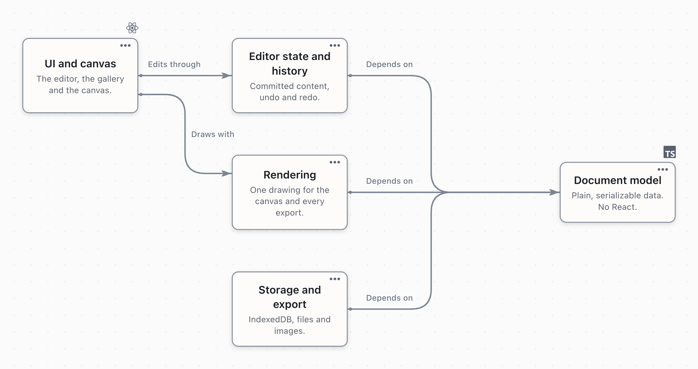

# Architecture

Why Draft Canvas's code is shaped this way. The rules themselves are in [AGENTS.md](../../AGENTS.md);
scripts and wiring are in the [development reference](development.md).

## Principles

- **The document is the product.** Files outlive any framework or renderer.
- **Local-first.** No account or server; diagrams stay on the device.
- **The owner hosts.** Collaborators connect to the owner's copy; no service holds a diagram.
- **Shared rendering.** Canvas and exports draw from the same description.
- **Model meaning, not technology.** Shapes are roles; technology names are labels.
- **Suggest, never block.** Offer defaults; never forbid a valid design.
- **Derive, don't duplicate.** Views and suggestions are computed from content, deterministically.
- **Degrade without destroying.** Keep usable content; report what is lost.
- **One action per capability.** Menus, shortcuts and the palette call the same operation.

**Deliberately not built:** accounts, cloud sync, a hosted collaboration service, cloud-provider icon
packs, standalone image nodes and a built-in AI generation service.

## Shape of the system

<!-- Drawn in Draft Canvas: ../media/reference/architecture.json, rendered by e2e/og-diagram.ts. -->


Dependencies point one way, toward `src/document/`: plain data with no React or React Flow. Each
module's allowed imports are in AGENTS.md, and `tests/layering.test.ts` enforces them. Library and
editor are two states of `src/App.tsx` with no router, so the build works from any path.

## The document model

- A document is a tree of graphs: a shape can own a room with the detail inside it. Copy and delete
  carry the room along, and cycles cannot exist.
- The editor edits the current room through a lens, so operations ignore depth.
- Operations return new documents that reuse unchanged elements, which keeps snapshot history cheap.
- Notes and code on a shape or connector are an embedded `attachments` array on the host, not graph
  nodes: they have no position, z-order or parent.

## The canvas boundary

- The store owns content; React Flow is a controlled view. The document is not written during a drag.
- One gesture is one undo entry; continuous edits such as typing coalesce.
- Camera moves are saved but are never content edits or undo steps.

## One renderer

Shapes and text are pure display lists (`nodes/describe.ts`, `render/text/layout.ts`) shared by
canvas and export. Selection, handles and other chrome are React and CSS only, so they never reach an
export. A style changes how a shape looks, never its size, where a connector meets it, or what it
means.

## The two seams

| Seam | Failure mode |
| --- | --- |
| Two independent connector renderers: `canvas/DraftEdgeView.tsx` and `edges/describe.ts` | A badge, dash or chip added to one is missing from the other. `edges/kindStyle.ts` and `e2e/line-jumps.spec.ts` cover part of it. |
| Side effects in a React state updater | Development mode runs updaters twice, so the effect happens twice, such as a drag recorded twice. |

## Relationship model

One sparse capability matrix, keyed by both endpoints' categories, says what a connection probably
means. Connector defaults, the relation picker, starters and suggestions all read it. An unlisted
pairing stays free; an unusual one gets guidance, not rejection.

## Connector routing

- **Semantic graph vs. routing graph.** Spines, bundles and line jumps are presentation: never nodes,
  never saved, no effect on semantics. Spine geometry is relative to the hub, so it follows a drag
  without writing the document.
- **A stored anchor is a pin.** Routing never changes its side or point; only its own reply line
  steps beside it, and connectors pinned to one point spread within a quarter of a handle gap. An end
  without an anchor faces the other shape and moves with it. Nothing guesses a pin from geometry:
  only **Auto attach** and **Pin ends here** turn one into the other. **Tidy connectors** clears only
  route modes and bends.
- **One route function.** Canvas, export and agent checks all call `edgeRoutes`
  (`edges/edgeRoutes.ts`): export and agents through `edges/connectorRoutes.ts`, the canvas with live
  geometry so a drag stays responsive. Its passes run in one order with no cycles, and lines settle in
  id order within a fixed budget, so every caller draws the same lines.
- **Sides are a repair, not a restyle.** `edges/sides.ts` revisits only a line that crosses another
  connector, runs through a shape or had to be searched for, and keeps another side only when it is
  clear. A clean line is never touched, so a laid-out diagram draws as it did.
- A line the pathfinder cannot clear says `blocked` or `budget` rather than passing as clear. Gesture
  frames are drawn the quick way and never searched; the drop settles them.
- Agent repair checks the complete view before accepting a candidate, since a shared corridor can
  move lines that share no endpoint. Explicit routes and hand-placed bends stay as authored.
- Hover traces are transient: absent during gestures, outage walks and presentation, off under
  reduced motion, and never exported or saved.

## Flows and presentation

- A flow orders references to existing connectors; several flows share one diagram.
- A step usually names a connector. A frame step spotlights shapes without one.
- A selected flow acts as a lighter lens, except during presentation or focus, or when empty.
- Playback, emphasis and camera guidance are never saved, undone or exported. A presenter's pan takes
  the camera until guidance is requested again.
- A flow reads as a sequence through one model (`sequence/build.ts`); **Draw the flow as a sequence**
  turns that reading into a native sequence.
- Nothing writes a diagram in another tool's format. The native file is the interchange format; PNG
  and SVG are the pictures.
- Nothing infers timing, outcomes or execution.

## Sequences

A sequence is one node (`type: 'sequence'`) with a nested, coordinate-free payload: semantic model →
operations → checks → layout → display list → interaction overlay.

- The layout (`sequence/layout.ts`) is a deterministic timeline solver that also answers hit-tests and
  insertion slots. `nodes/sequence.ts` turns it into the display list every node uses, so canvas, PNG
  and SVG agree.
- The node's size follows its content: a snug box stays snug, and an enlarged one is kept until it
  must grow.
- The interactive layer (`canvas/sequence/`) is mounted only while the node is hovered, selected, a
  drop target or presenting. Sub-selection and the open editor are transient.
- Presenting plays a derived, never-saved flow, one step per message, through the existing playback.
- Agents send and read a sequence as Mermaid `sequenceDiagram` text (`sequence/native/mermaid.ts`),
  the text import reads. It is the agent protocol, not an export.

## Command surface

`commands/registry.ts` derives commands from selection, mode and document on demand; each calls one
existing store action. The context menu (`commands/contextMenu.ts`) is a flat, curated subset of the
same commands, sometimes with shorter labels. It leaves out any command that opens a follow-up picker
(a `CommandStage`, such as **Connect to…**).

## Derived capabilities

- **Starters** are content, not code: `.draftcanvas` files in the public
  [draft-canvas-starters](https://github.com/acltabontabon/draft-canvas-starters) gallery, read only on
  request and checked against the catalog's hash and the file parser before they are kept. Adding one
  is one undo step.
- **Next-shape suggestions** rank shapes from the selection's neighbourhood; only high confidence
  shows unprompted.
- **Open points** attach to element ids and never affect geometry, routing or semantics.
- **Sketches** are per-room annotation, never obstacles, members or semantics. The stroke being drawn
  bypasses React and reaches the document as one stroke at pen-up.
- **Smart Ink** keeps geometry (`ink/recognize.ts`) apart from meaning (`ink/interpret.ts`), which
  offers only existing shape kinds. Strokes are kept as ink first, so a conversion is one undo step
  that undo reverses to the strokes.
- **Linked junctions** share `DraftNode.link`, an opaque group id on the Junctions themselves. With no
  table of groups, membership cannot dangle or disagree with a copy, an undo or a collaborator's edit.
  A link is not a connector, and travelling along one is camera arithmetic that is never saved,
  undone or shared.
- **View levels** change how rooms are shown, not the tree.

## Persistence and the storage boundary

- The editor sees plain documents; storage owns reading, writing and recovery.
- Browser storage keeps summaries apart from bodies, so the library lists without loading canvases. A
  save writes both in one transaction.
- Content writes check for intervening changes, and conflicts always ask. Camera-only saves never
  conflict and never show as unsaved.
- Reading never rewrites. Unreadable data is kept, never replaced with an empty diagram.
- A failed autosave keeps the document and says why; panning does not retry it. The reload stash
  covers a same-tab refresh only and fails when storage is full.
- Backups skip unreadable diagrams and say so; a partial backup does not reset the last-backup date,
  and a missing project manifest fails the backup. Restore never overwrites a diagram, but retrying
  after a storage error may add extra copies.
- Desktop saves replace the file atomically, and unsaved work is kept as recovery copies in the app's
  data folder. Neither replaces an exported backup.

**Docs images.** `export/docs/` draws the picture a Markdown page shows with the export renderer, in
the app where text is measured, never with the diagram embedded. The SVG (`name.svg` beside
`name.draftcanvas`) carries a note naming the level, look and whether it follows saves; there is no
manifest.

After any save, including an agent's, a picture that follows saves is redrawn. Only an SVG with that
note is replaced, identical bytes are skipped, and a Markdown file only gets an insertion into the
text the person read.

**Richer previews: decided, not built.** A custom fenced block (```` ```draftcanvas ````) works only
in a viewer that knows it, never on GitHub, so the portable SVG ships alone. A viewer could read the
note (`readMarker`, `export/docs/marker.ts`) to swap in an interactive view, reusing
`renderDocumentSvg` rather than a second renderer and loading no remote script.

**Diagram history.** Each diagram has its own Git repository, kept apart from the file. See
[Canvas Evolution](evolution.md) for its design and security.

**Encrypted storage.** Browser records are written plain. `crypto/documentCipher.ts` and
`crypto/keyStore.ts` only decrypt legacy rows, and only `storage/IndexedDbRepository.ts` calls them.
The passphrase export is separate. See [Security](../../SECURITY.md#browser-storage).

## Untrusted input and schema evolution

Files, clipboard, stored records and collaboration changes pass one migrate-and-validate boundary.
Recoverable defects are repaired and reported; newer formats are refused by name.

## Desktop

The desktop shell owns files, saving and recovery. The editor reaches it only through `DesktopApi`,
so desktop screens also run against a fake shell. Agent edits use the same operations, stay
provisional until committed, and join the normal undo history
([Agent integration](agent-integration.md)).

## Live collaboration

- The owner's editor holds the authoritative file and saves it as usual. Others connect over WebRTC,
  or through the desktop app's LAN relay.
- The rendezvous relay forwards only the connection handshake, sealed with a key from the link's
  fragment; direct invites work without it. What it keeps is in
  [Website](website.md#the-collaboration-relay).
- Changes travel per element id. The owner sanitizes each like an import, repairs dangling references
  and broadcasts a numbered commit. Collaborators show the confirmed file plus their pending changes,
  and property tests check that every copy converges on the owner's.
- Every fresh copy sent to a collaborator starts a new epoch: the owner drops older patches, and the
  collaborator resends whatever is unconfirmed as one patch.
- A held gesture delays incoming changes. Undo reverts only your own edit, never work built on it.
  Cameras, selection and presence never enter the document.
