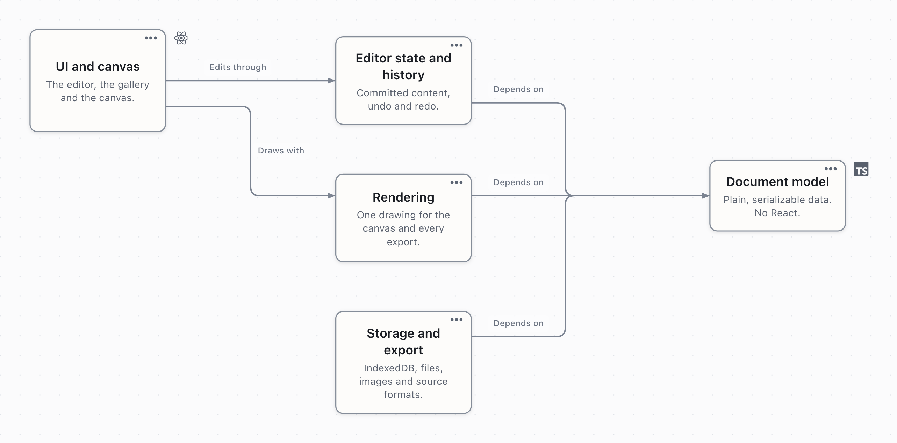

# Architecture

Draft Canvas centers on a portable document. The editor, presentation and exports are views of that
model, built to help someone explain software without spending the meeting arranging a diagram.

Implementation rules are in [AGENTS.md](../../AGENTS.md); module wiring and commands are in the
[development reference](development.md).

## Principles

| Principle | Purpose |
| --- | --- |
| **The document is the product** | Keep files usable beyond any framework or rendering library. |
| **Local-first** | Editing requires no account or server; diagrams stay on the device. |
| **Shared rendering** | Keep the canvas and exported images visually consistent. |
| **Model meaning, not technology** | Use architectural roles; technology names belong in labels. |
| **Suggest, never block** | Offer useful defaults without forbidding a valid design. |
| **Derive instead of duplicate** | Compute views and suggestions from existing content. |
| **Deterministic assistance** | The same diagram and selection produce the same suggestions. |
| **Degrade without destroying** | Preserve usable content and report what cannot be recovered. |
| **One action per capability** | Menus, shortcuts and the palette call the same operation. |

## Shape of the system

<!-- Drawn in Draft Canvas: ../media/reference/architecture.json, rendered by e2e/og-diagram.ts. -->

Dependencies point toward the document model. It contains plain, serializable data and has no React
or React Flow dependency. Framework changes therefore do not dictate the file format.

## The document model

A document is a tree of graphs: a shape can own the architecture inside it. Ownership makes copying
and deleting a shape carry its detail along, and prevents cyclic room references. The editor works
through a lens on the current room, keeping ordinary editing independent of navigation depth.

Operations return new documents while sharing unchanged elements. This makes snapshot history
practical and lets consumers identify changes without comparing every field.

## The canvas boundary

The store owns committed content; the canvas holds a gesture's temporary state until it finishes.
One completed gesture creates one undo entry, and continuous edits such as typing coalesce.
Camera movement can be saved without becoming a content edit or an undo step.

## One renderer

Shapes and text use shared drawing descriptions for the canvas and image exports. Selection,
handles and other interactive chrome stay outside that drawing, so they cannot leak into exports.
Drawing styles parameterize the same renderer rather than introducing separate implementations.

Connectors remain a consistency seam: their screen and export renderers are separate.

## Relationship model

A single capability matrix describes likely relationships between endpoint categories. Connector
defaults, the relation picker, starters and suggestions use it, keeping their interpretation aligned.

The matrix is deliberately sparse. An unspecified pairing retains full freedom, and an unusual
connection receives guidance rather than rejection. Detailed rules are in [Semantics](semantics.md).

## Flows and presentation

Flows order references to existing connectors, allowing several stories to share one diagram.
Presentation and sequence exports read those authored steps; they do not simulate execution or
infer outcomes. Playback, emphasis and camera guidance are transient, and the presenter can take
over the camera without changing the diagram.

## Derived capabilities

Starters produce ordinary diagram content. Continuation suggestions use the selected shape and its
neighborhood. Commands expose existing actions, and sequence exports read existing flows. These
capabilities reuse the model rather than creating parallel representations to keep synchronized.

Open points are annotations attached by element id, so one question can concern several elements
without changing their geometry or semantics. View levels derive how rooms are shown while keeping
the underlying tree intact.

## Persistence and the storage boundary

The editor sees plain documents; storage owns reading, writing and recovery. Browser storage keeps
summaries separate from diagram bodies so the library can list documents without loading every canvas.
Desktop storage uses ordinary files and recovery copies for unsaved work.

Content writes detect intervening changes before replacing stored data. Camera-only saves avoid
content conflicts. Reading a document does not rewrite it, and unreadable data is preserved rather
than silently replaced with an empty diagram. Storage failures are reported instead of hidden.

Storage formats and older encrypted records are covered in [Privacy](privacy.md); the threat model
and encryption boundaries are in [Security](../../SECURITY.md).

## Untrusted input and schema evolution

Files, clipboard content and stored records pass through one migration and validation boundary
before reaching the editor. Recoverable defects are repaired with a report; unsupported newer
formats are refused explicitly. The goal is to retain valid work without trusting incoming data.
See [Document schema](schema.md) for the format and migration contract.

## Desktop

The desktop app hosts the same editor. The browser owns its IndexedDB documents; the desktop shell
owns file access, saving and recovery. Keeping native capabilities behind a host interface makes
shared editing independent of the platform and lets the desktop screens run against a fake shell.

Optional agent access uses the same document operations and commit boundary. Permissions limit its
scope, retries and cancellation must not create duplicate or late edits, and previews remain
provisional until committed. Agent edits join the same undo history as manual edits. Protocol and
permission details are in [Agent integration](agent-integration.md).

## Deliberately not built

Accounts, cloud sync, real-time collaboration, cloud-provider icon packs, standalone image nodes
and a built-in AI generation service remain outside the editor's scope. Optional local agent
integration and Mermaid import extend how a diagram is authored without adding an editor backend.
