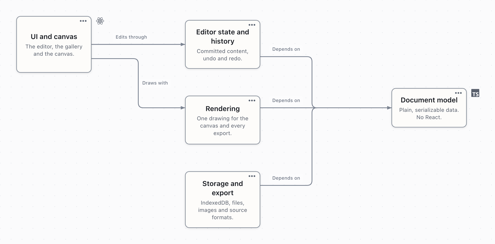

# Architecture

Why the code is shaped this way. Rules: [AGENTS.md](../../AGENTS.md). Scripts and wiring:
[development reference](development.md).

## Principles

- **The document is the product.** Files outlive any framework or renderer.
- **Local-first.** No account or server; diagrams stay on the device.
- **The owner hosts.** Collaborators connect to the owner's copy; no service holds a diagram.
- **Shared rendering.** Canvas and exports draw from the same description.
- **Model meaning, not technology.** Shapes are roles; technology names are labels.
- **Suggest, never block.** Offer defaults; never forbid a valid design.
- **Derive, don't duplicate.** Views and suggestions are computed from content, deterministically.
- **Degrade without destroying.** Keep usable content; report what is lost.
- **One action per capability.** Menus, shortcuts and the palette call the same operation.

## Shape of the system

<!-- Drawn in Draft Canvas: ../media/reference/architecture.json, rendered by e2e/og-diagram.ts. -->


Dependencies point toward `src/document/`, which is plain data with no React or React Flow.

| Module | Imports only |
| --- | --- |
| `document/` | `lib/` |
| `depth/`, `gallery/` | `document/` |
| `layout/` | `document/`, `edges/bundles` |
| `collab/` | `document/`, `depth/`, `lib/`, its own `transport/` |
| `continuation/` | `document/`, `edges/routing`, `edges/clearance`, `edges/compensationMarker`, `render/text` |
| `openPoints/` | `document/`, `depth/`, `render/` |
| `agent/` | the above plus rendering and export; never UI or store |

Library and editor are two states of `src/App.tsx` with no router, so the build works from any path.

## The document model

- A document is a tree of graphs: a shape can own a room with the detail inside it. Copy and delete
  carry the room along, and cycles cannot exist.
- The editor edits the current room through a lens, so operations ignore depth.
- Operations return new documents that reuse unchanged elements, which keeps snapshot history cheap.
- Notes and code on a shape or connector are an embedded `attachments` array on the host, not graph
  nodes: they have no position, z-order or parent.

## The canvas boundary

- The store owns content; React Flow is a controlled view. The document is not written during a drag.
- One gesture is one undo entry. Continuous edits such as typing coalesce.
- Camera moves are saved but are never content edits or undo steps.

## One renderer

Shapes and text are pure display lists (`nodes/describe.ts`, `render/text/layout.ts`) shared by canvas
and export. Selection, handles and other chrome are React and CSS only, so they never reach an export.
Drawing styles are parameters of that renderer and a device preference, not document data.

## The two seams

| Seam | Failure mode |
| --- | --- |
| Two independent connector renderers: `canvas/DraftEdgeView.tsx` and `edges/describe.ts` | A badge, dash or chip added to one is missing from the other. `edges/kindStyle.ts` and `e2e/line-jumps.spec.ts` cover part of it. |
| Side effects in a React state updater | Development mode runs updaters twice; this once recorded every drag twice. |

## Relationship model

One sparse capability matrix, keyed by both endpoints' categories, says what a connection probably
means. Connector defaults, the relation picker, starters and suggestions all read it. An unlisted
pairing stays free; an unusual one gets guidance, not rejection. Rules: [Semantics](semantics.md).

## Connector routing

- **Semantic graph vs. routing graph.** Spines, bundles and line jumps are presentation: never nodes,
  never saved, no effect on semantics.
- A stored anchor is a pin: routing never changes its side or point (only its own reply line steps
  beside it, and connectors pinned to one point spread within a quarter of a handle gap). An end
  without one is automatic: it faces the other shape and moves with it. Nothing guesses a pin from
  geometry; **Auto attach** and **Pin ends here** are the only ways one becomes the other.
  **Tidy connectors** clears only route modes and bends.
- Export and agent checks read `connectorRouteInputs` / `connectorRoutes` in
  `edges/connectorRoutes.ts`. The canvas gathers live geometry through per-connector subscriptions
  and passes equivalent inputs to the same `edgeRoutes` function, so a drag remains responsive. A
  browser check compares the settled canvas path with the accessor's path. The passes run in one
  order with no cycles: sides and trunk membership, then where automatic ends sit
  on a side (`edges/endpoints.ts` spreads ends sharing a side, and pins sharing one point within
  their band), then which side a troubled line should have used instead (`edges/sides.ts`, below)
  and those ends placed again, then the raw routes (`edges/edgeRoutes.ts`), then parallel tracks for runs sharing a
  corridor (`edges/separation.ts`, each shift checked and kept only if it clears shapes and adds no
  crossing), then labels, label groups and line jumps on the final lines. A stepped
  line is checked against the shapes; when it is blocked, `edges/pathfinder.ts` searches for a clear
  one within the area its shapes were collected from, and a line it cannot clear says `blocked` or
  `budget` rather than passing as clear. Gesture frames are never searched.
- **Sides are a repair, not a restyle.** Two shapes alone choose the facing sides across their wider
  gap. `edges/sides.ts` revisits only a line with something wrong — it crosses another connector,
  runs through a shape, or had to be searched for — and tries its automatic ends on the other
  sides, drawn the quick way and kept only when clear. One scale decides: length, a bend, a crossing,
  a run shared with another line. A clean line is never touched, so a laid-out diagram draws as it
  did; pins, bends, trunks, parallel pairs and shared labels are only routed around. Lines settle in
  id order within a fixed budget, so canvas, export and agent checks agree. A gesture's frames
  draw a moving shape's lines the quick way and the drop settles them.
- Agent repair screens candidates locally, then checks the complete view before accepting one: a
  shared corridor can move lines that share no endpoint. After selecting the layout, a bounded
  polish pass removes avoidable crossings and detours only if it preserves readable neighbours,
  shared trunks and overall quality. Explicit routes and hand-placed bends remain authored.
- A request/reply Z nests its middle runs; endpoint lane offsets alone would stack them. Caption
  sides follow the final drawn rails, including corridor separation. A small glyph that cannot
  align its automatic end may instead align the other, unpinned end. Two differently labelled
  operations keep independent exits rather than forming a two-member fork.
- Hover traces are transient SVG paths: once per hover, absent during gestures, Traffic and
  presentation, disabled by reduced-motion CSS, and never exported or persisted.
- Spine geometry is relative to the hub, so it follows a drag without writing the document.
- The connection target shows where a release will land before the pointer is released.

## Flows and presentation

- A flow orders references to existing connectors; several flows share one diagram.
- A step usually names a connector. A frame step spotlights shapes without one.
- A selected flow acts as a lighter lens, except during presentation or focus, or when empty.
- Playback, emphasis and camera guidance are never saved, undone or exported. A presenter's pan takes
  the camera until guidance is requested again.
- Sequence export writes every playable flow, and every native sequence, to one Mermaid or PlantUML file. The text is the product.
- Nothing infers timing, outcomes or execution.

## Sequences

A sequence is one node (`type: 'sequence'`) with a nested, coordinate-free payload: semantic model →
operations → checks → layout → display list → interaction overlay.

- `document/sequenceOps.ts` holds the pure operations; `sequence/check.ts` the findings;
  `sequence/layout.ts` a deterministic timeline solver (columns from label widths, rows in document
  order, nested fragment bands) that also answers hit-tests and insertion slots.
- `nodes/sequence.ts` turns the layout into the same display list every node uses, so canvas, PNG
  and SVG agree. A participant's head is `describeNode` on a compact synthetic shape: the real
  Service, Data Store, Queue, Actor or Component, with its technology mark.
- The node's size follows its content (`nodes/sequenceFit.ts`), applied in the store's `apply` and
  in the agent's update: a snug box stays snug, an enlarged one is kept until it must grow.
- `canvas/sequence/` is the only interactive layer, mounted while the node is hovered, selected, a
  drop target or presenting. Sub-selection (`uiStore.sequenceFocus`) and the open editor are
  transient, never saved or undone.
- Presenting plays a derived, never-saved flow (`document/sequenceFlow.ts`), one step per message,
  through the existing playback.
- Mermaid and PlantUML are written by `sequence/native/`; Mermaid is read by
  `import/mermaid/sequence.ts`. Agents send and read the same Mermaid text (`agent/sequences.ts`).

## Command surface

`commands/registry.ts` derives commands from selection, mode and document on demand. Each calls one
existing store action. The context menu (`commands/contextMenu.ts`) is a flat, curated subset of the
same commands, sometimes with shorter labels, minus any that open a follow-up picker (a
`CommandStage`, such as **Connect to…**).

## Derived capabilities

- **Starters** are `.draftcanvas` files in the public starters gallery
  ([draft-canvas-starters](https://github.com/acltabontabon/draft-canvas-starters)), not part of the
  app. `gallery/` reads them on request: `remote.ts` is the app's one `fetch`, to that repository
  only, and every file is hashed against `catalog.json` and opened through `parseDocument` before it
  is kept in its own IndexedDB database. Adding one is a paste of the whole file (`pasteDocument`),
  flows included, as one undo step. The Order processing example ships in `gallery/example/`.
- **Continuation** ranks next shapes from the selection's neighborhood; only high confidence shows unprompted.
- **Open points** attach to element ids; they never affect geometry, routing or semantics.
- **View levels** change how rooms are shown, not the tree.

## Persistence and the storage boundary

- The editor sees plain documents; storage owns reading, writing and recovery.
- Browser storage keeps summaries apart from bodies, so the library lists without loading canvases.
- Desktop storage uses ordinary files plus recovery copies.
- Content writes check for intervening changes. Camera-only saves never conflict.
- Reading never rewrites. Unreadable data is kept, never replaced with an empty diagram.

**Docs images.** `export/docs/` draws the picture a Markdown page shows with the export renderer,
never with the diagram embedded. The link to its source is the SVG itself: it sits beside
`name.draftcanvas` as `name.svg` and carries a note naming the level, look and whether it follows
saves. There is no manifest. After any save, including an agent's, `desktop/docs.ts` redraws a
following picture from the saved text. `src-tauri/src/docs.rs` replaces only an SVG with that note,
skips identical bytes, and adds to a Markdown file only an insertion into the text the person read.
Pictures are drawn where text is measured, in the app, so there is no headless renderer to drift
from it.

**Richer previews: decided, not built.** A custom fenced block (```` ```draftcanvas ````) only works
in a viewer that knows it, never on GitHub. Building it now would split effort from the portable
SVG, so this release ships the SVG alone. The extension point is the note in every docs image:
`readMarker` (`export/docs/marker.ts`) gives a viewer the `.draftcanvas` beside the SVG and the level
it shows. A Markdown preview (VS Code, a docs site) can swap the image for an interactive view of
that level. It should reuse `renderDocumentSvg` and the reader, never a second renderer, and load no
remote script.

**Encrypted storage.** Browser records are written plain. `crypto/documentCipher.ts` and
`crypto/keyStore.ts` only decrypt legacy rows and are called only by `storage/IndexedDbRepository.ts`.
The passphrase export is separate. See [Security](../../SECURITY.md#browser-storage).

## Untrusted input and schema evolution

Files, clipboard, stored records and collaboration changes pass one migrate-and-validate boundary.
Recoverable defects are repaired and reported; newer formats are refused by name. See
[Document schema](schema.md).

## Desktop

The desktop shell owns files, saving and recovery. The editor reaches it only through `DesktopApi`,
so desktop screens also run against a fake shell. Agent edits use the same operations, stay
provisional until committed, and join the normal undo history ([Agent integration](agent-integration.md)).

## Live collaboration

- The session owner's editor holds the authoritative file and saves it as usual. Others connect over
  WebRTC, or through the desktop app's LAN relay.
- A stateless rendezvous relay ([`relay.js`](../../www/cloudflare/relay.js)) forwards only the
  connection handshake, sealed with a key from the link's fragment. It keeps a fingerprint of the room
  secret until 12 hours after the owner was last connected. Direct invites work without it.
- Changes travel per element id (`collab/diff.ts`). The owner sanitizes each like an import
  (`collab/sanitize.ts`), repairs dangling references (`collab/repair.ts`) and broadcasts a numbered commit.
- Collaborators show the confirmed file plus their pending changes (`collab/replica.ts`). Property
  tests check that every copy converges on the owner's.
- Every fresh copy sent to a collaborator (joining, reconnecting, after a gap) starts a new epoch. The
  owner drops patches from before it; the collaborator resends whatever is unconfirmed as one patch.
- A held gesture delays incoming changes. Undo reverts only your own edit, never work built on it.
  Cameras, selection and presence never enter the document.

## Deliberately not built

Accounts, cloud sync, a hosted collaboration service, cloud-provider icon packs, standalone image
nodes, a built-in AI generation service.
