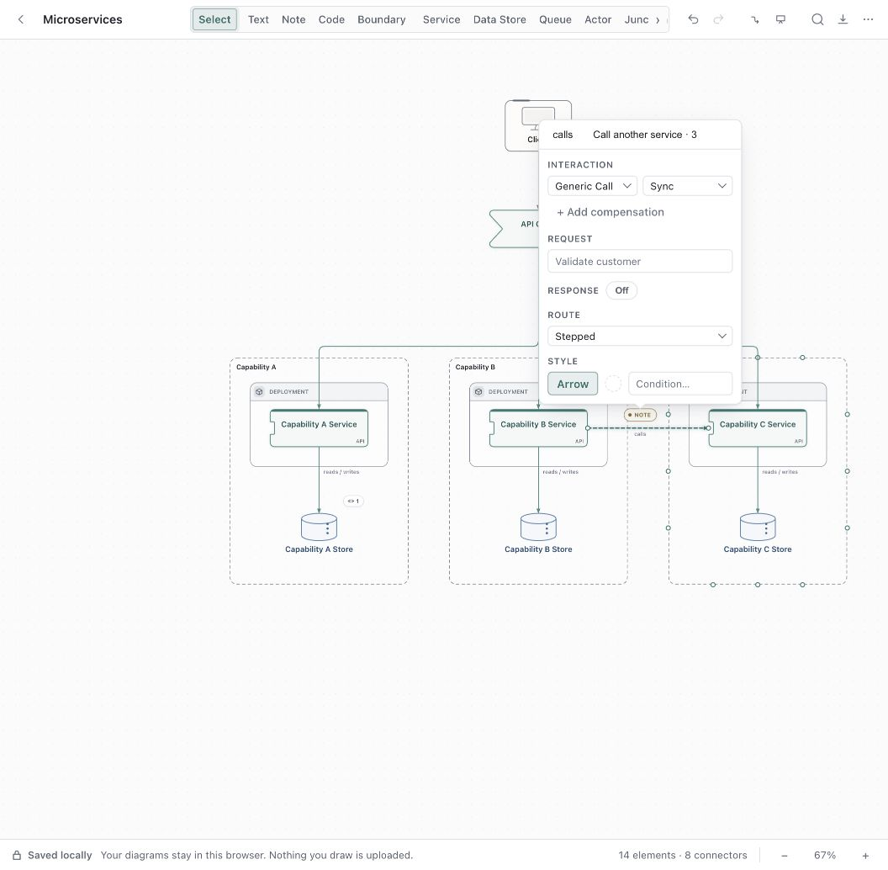

# Draft Canvas connector experience audit

The highest value improvements are consistent Sync and Async controls, routing that checks the whole detour, and label placement that respects nearby shapes. Manual bend editing would then give authors a predictable way to finish tidying a diagram when automatic routing cannot express their intent.

Audit date: October 19, 2026. Baseline: `1905d10b7c4ba7d37455b252cfa1f8c4d7577821` on `main`, version 1.14.0. The audit used a separate worktree and synthetic diagrams. The findings below record the baseline before the fixes in this worktree.

## Fixes in this worktree

The five confirmed issues have focused fixes on `audit/connector-ux`:

- The router validates complete detour candidates, including endpoint legs and rounded corners,
  against nearby obstacles before choosing one.
- Custom labels use measured chip bounds and can flip or slide along the same path to avoid an
  unrelated shape. Canvas, export, shared label planning and crossing planning use the same inputs.
- Service Sync/Async actions share one store action across the inspector, context menu and palette.
  Async hides the response line and keeps its text; the request's stroke style stays independent.
- Duplicate reconnects no longer advertise a valid target, explain the rejected drop with a message,
  and do not add history. Invalid duplicate targets are omitted from the palette.
- Endpoint hit areas stay at least about 20 screen pixels for a mouse, with larger touch targets,
  rather than shrinking with the visible dot when zoomed out.

Manual bend editing arrived separately on `main` in PR #60. This PR preserves it and applies the
same label collision handling to manually bent connectors. The inspector and keyboard experience
improvements remain proposals. Regression coverage is in
[connector unit tests](../../tests/connector-tidiness.test.ts) and
[connector browser tests](../../e2e/connector-tidiness.spec.ts).

## Fix verification

`npm run check` passed: lint, tooling type checks, production build and all 4,067 unit tests after rebasing onto `0349337`.
The focused Chromium coverage passed across 57 scenarios for connector interactions, picking,
attachments, shared labels, smart routing, response labels and reconnection. Five connector and
response-label regressions also passed in dark mode. Documentation links, anchors and whitespace checks passed.

Firefox, WebKit and native Tauri were not run for these fixes.

## Findings at the audit baseline

### Sync and Async controls disagree

**Priority: high. Reproduced in the browser.** In the Microservices starter, select the connector from Capability B Service to Capability C Service. Right-click it and choose **Make asynchronous**. The connector becomes dashed, but its inspector still says **Interaction mode: Sync** and still offers **Response line**.

The context action changes `edge.async`; the inspector reads and writes `edge.kind`. These can describe contradictory states. The inspector intentionally separates mode from line style, but the context action names a style change as a mode change. The user guide also describes the two actions as equivalent.

Use one store action for changing interaction mode from every entry point. If independent line styling is intentional, name those actions **Dashed line** and **Solid line**, expose them under Style, and reserve Sync and Async for interaction behavior. Preserve response text while applying a consistent response visibility rule. Verify inspector, context menu, command palette, undo, save/reopen, canvas and export together.

Evidence: [context actions](../../src/commands/registry.ts), [inspector mode](../../src/canvas/EdgeInspectorPopover.tsx), [toggleEdgeAsync](../../src/store/editorStore.ts), and [current guide](../guides/shapes-and-connectors.md#sync-async-and-the-reply).

### An obstacle detour can cross another shape

**Priority: high. Reproduced through the shared routing function.** The router picks a detour using shapes that block the original corridor. It does not validate the resulting path against shapes beside that corridor. A connector can therefore avoid one shape by running through another.

Minimal rectangles, expressed as `[x, y, width, height]`:

- Source: `[0, 0, 160, 80]`.
- Target: `[600, 0, 160, 80]`.
- Main blocker: `[300, 0, 160, 80]`.
- Second blocker: `[200, -50, 80, 50]`.

Calling `routeBetween(source, target, 'smoothstep', { obstacles: [main, second] })` produces a horizontal detour at `y = -16`, which crosses the second blocker. `runsThroughEnds` confirms that intersection. This is a geometry reproduction, not a browser screenshot reproduction.

Validate every segment of each proposed detour against the nearby obstacle set. Try both sides before choosing a corridor; use bounded orthogonal search if neither candidate is clear. Keep this in the shared routing code so canvas and export agree. Regression checks should include stacked obstacles, mixed endpoint sides, close gaps and routes that remain blocked on both sides.

Evidence: [detourAround and buildDetourPath](../../src/edges/routing.ts), [nearby obstacle lookup](../../src/edges/obstacles.ts).

### A connector label can cover an unrelated shape

**Priority: medium. Reproduced through shared geometry and label layout functions.** Ordinary label placement checks the source and target, but does not reserve the full text rectangle against other nearby shapes. Shared label grouping has more collision checks, so that protection is uneven.

With the same source and target above, put a third shape at `[330, 0, 100, 29]`. The line remains at `y = 40`, clear of that shape. A custom label **Payment requested** produces a chip rectangle approximately `[318.105, 16.175, 95.79, 18.825]`, overlapping the third shape. This was reproduced with `routeBetween`, `layoutEdgeLabel` and `labelChipBox`.

Place the measured label rectangle, including conditions and response text where present, against nearby shapes and other labels. Try the opposite side, then slide along the same segment. Keep placement deterministic and avoid whole-graph scans on pointer movement. A later manual label position control can provide an escape hatch.

Evidence: [placeLabel](../../src/edges/routing.ts), [label dimensions](../../src/edges/labelLayout.ts), [shared label collision handling](../../src/edges/labelGroups.ts).

### Invalid reconnects silently return to their old target

**Priority: medium. Reproduced in the browser.** In Microservices, drag the target of API Gateway → Capability A Service onto Capability B Service. Nothing changes because Gateway → B already exists. The same drag onto Client succeeds, confirming the gesture works.

Preventing a duplicate is reasonable, but the preview target lookup does not use the duplicate guard applied at commit. The gesture gives no explanation for its refusal. Command palette target candidates also do not filter duplicate pairs.

Share a pure eligibility result between preview, palette and commit, including a short reason. Show **Already connected** near an invalid target or offer **Select existing connector** after release. Avoid an undo entry for a rejected drop. Preserve the existing rule allowing a connector to change sides on its current target even when a parallel connector exists.

Evidence: [findDropNode and reconnect preview](../../src/canvas/DraftEdgeView.tsx), [commit guard](../../src/document/operations.ts), [palette candidates](../../src/commands/registry.ts).

### Reconnect targets become too small at low zoom

**Priority: medium. Measured in the browser.** At 67% zoom the visible dot measured about 6 pixels, but an invisible hit ring expands it to roughly 16 pixels. At 32% zoom that hit ring measured only about 7.7 screen pixels because its size is capped at 24 flow units. The small visible dot alone is therefore not the defect; the capped hit ring is.

Keep the interaction area stable in screen pixels throughout the supported zoom range, while allowing the drawn dot to remain small. Make endpoints easier to identify with a source/target hover label. Check actual pointer hits at 25%, 50%, 100% and 200%, including short connectors where endpoint areas overlap. Touch has separate larger hit rings and needs its own checks.

Evidence: [endpoint hit sizing](../../src/styles/canvas.css), [endpoint control](../../src/canvas/DraftEdgeView.tsx).

## Recommended experience improvements

### Let authors adjust a bend directly

**Highest value new capability.** A selected connector currently exposes two endpoint handles and a **Stepped / Curved / Straight** picker. There is no draggable middle segment, bend point or persisted waypoint. Authors have to move shapes, alter endpoint anchors or add a Junction to influence the route. A Junction changes graph structure, so it should remain a deliberate branching choice.

Start with segment dragging for stepped connectors. Show one subtle grip on hover or selection; drag a horizontal segment vertically and a vertical segment horizontally. Snap to nearby segment coordinates and the grid, with a modifier to bypass snapping. Preview locally while dragging, commit one history entry on release, and cancel with Escape. Provide **Reset route** on the selected connector.

Persist only explicit route intent, with automatic routing as the default. Manual geometry needs a schema proposal, validation and migration through every room, worker-safe agent support, and shared canvas/export routing. Endpoint movement must have a defined policy for preserving or resetting bends. Validate save/reopen, undo/redo, copy/paste, node movement, room navigation and export before shipping.

### Make connector controls quieter and routing choices clearer

**Medium priority. Observed in the browser and source.** Selecting a connector immediately opens the full inspector. In the starter it covers unrelated shapes, including part of the Client and Gateway. Placement guards consider the selected connector's two endpoint rectangles, rather than all nearby content. The panel also offers a Route shape picker while **Use direct routing** and **Use smart routing** live in the context menu and palette. Direct routing means an independent route, which is easy to confuse with Straight.

Keep the essential edit controls in a compact contextual bar and let authors pin or expand details. Include **From → To** so a selected branch is identifiable. Put routing in one place with separate choices for **Shape: Stepped / Curved / Straight** and **Bundling: Automatic / Independent**. Offer endpoint reset and, once manual bends exist, route reset beside them. A panel should be dismissible while the connector remains selected for direct manipulation.

Use measured collision candidates or an optional side panel for the full editor. Verify long labels, response fields, narrow windows, both themes and keyboard focus before changing placement.

Evidence: [popover placement and expanded panel](../../src/canvas/EdgeInspectorPopover.tsx), [routing commands](../../src/commands/registry.ts), [edge routing model](../../src/document/types.ts).

### Bring endpoint placement to keyboard controls

**Medium priority. Confirmed in source and browser DOM.** The palette already supports **Reconnect source…** and **Reconnect target…**, so reconnecting is partly keyboard accessible. The visible endpoint controls themselves are plain divs without a label, role, tab stop or keyboard handler. Palette candidates exclude boundaries, although pointer reconnection explicitly supports dropping onto a boundary. The palette also cannot choose a side or offset on the current shape.

Expose named Source and Target controls with a node picker and **Automatic / Top / Right / Bottom / Left** attachment choices. Include boundaries where pointer reconnection permits them. Keep focus on the connector after changes and announce the new endpoint. Add offset choices only where they help; avoid turning the normal inspector into a geometry form.

Evidence: [endpoint DOM and pointer boundary support](../../src/canvas/DraftEdgeView.tsx), [endpointCandidates](../../src/commands/registry.ts), [accessibility guide](../guides/accessibility.md).

## Suggested order

1. Resolve Sync/Async naming and state consistency; make invalid reconnect feedback truthful.
2. Fix detour intersections and full label collision handling; enlarge low zoom hit areas.
3. Unify routing controls and improve endpoint keyboard parity.
4. Add segment dragging with reset and one-step undo, then refine inspector density around that workflow.

Preserve the existing strengths: wide connector picking, distinct hover and selection, shared routing for canvas and export, automatic bundles, shared labels, cancelable reconnects, and local-only transient previews.

## Audit verification

The audit ran 38 focused Chromium tests against the separate worktree preview: 8 connector picking tests, 13 connector attachment tests, 7 shared label tests, 3 smart routing tests and 7 reconnection tests. All passed. Browser inspection covered the Microservices starter, endpoint sizing, a valid reconnect, a duplicate reconnect and the context-menu Async action. Two additional pure geometry reproductions confirmed detour and label collisions.

The review did not run Firefox, WebKit, native Tauri, or a touch-device session. Product code was not changed, so the repository-wide code check was not run. The passing suites establish existing behavior; they do not cover the newly identified bugs.
