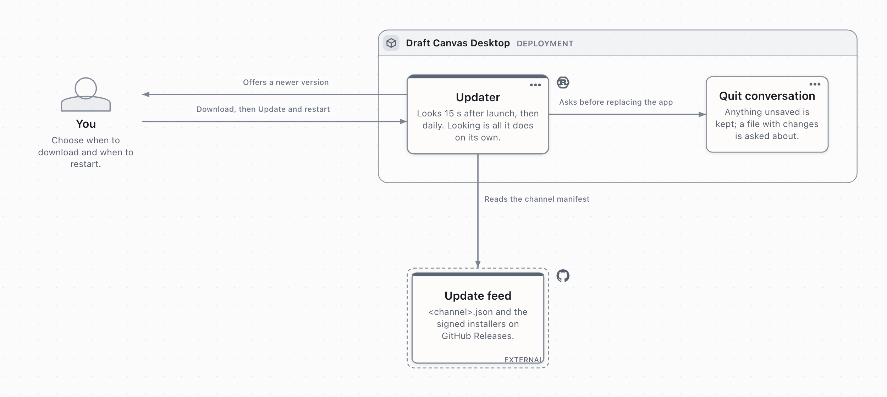

# Desktop updates

What users see is in [Draft Canvas Desktop](../guides/desktop.md#updates).

## How it works

<!-- Drawn in Draft Canvas: ../media/reference/desktop-updates.json, rendered by e2e/og-diagram.ts. -->


1. **Check.** 15 seconds after launch, then daily, the app reads
   `github.com/acltabontabon/draft-canvas/releases/download/desktop-updates/<channel>.json`.
2. **Offer.** A newer version shows **Update available**.
3. **Download.** **Download** fetches the package and verifies its signature.
4. **Restart.** **Update and restart** runs the quit flow: unsaved work is kept and changed files are
   asked about.

- Only checking is automatic. Settings has **Check for updates automatically** (on by default).
- The updater is Rust (`src-tauri/src/updater/`). The page has no updater permission; it calls the
  `update_*` commands. Installing uses the quit flow (`quit.rs`, `Purpose::Update`).
- A downloaded update lives in memory, so a restart re-downloads and re-verifies it.
- Nobody is downgraded. The installed version picks the channel:

| Installed | Reads | Is offered |
| --- | --- | --- |
| a prerelease (any `-suffix`) | `alpha.json` | the newest newer version, prerelease or release |
| a release | `stable.json` | newer releases only |

Windows updates use the signed NSIS `.exe`; macOS updates use `.app.tar.gz`. Keep the updater
plugin's `zip` feature off (it pulls in vulnerable ZIP code) and `rustls-tls` and `system-proxy` on.

## Versions

- A release is tag `vX.Y.Z`, matching `package.json`; web and desktop share it.
- A desktop preview is `desktop-vX.Y.Z-<suffix>` (for example `-alpha.1`). Its `X.Y.Z` may lead
  `package.json`, never trail it.
- Every version needs a dated `CHANGELOG.md` section. See [Releases](releases.md).

## The three kinds of signing

| Kind | Status | Secrets |
| --- | --- | --- |
| Update signing (Tauri minisign) | In use. The app refuses packages not signed by its built-in key for the announced version (`requireSignedVersion`). | `TAURI_SIGNING_PRIVATE_KEY`, `TAURI_SIGNING_PRIVATE_KEY_PASSWORD` |
| macOS code signing and notarization | Not configured; builds are ad-hoc signed | `APPLE_CERTIFICATE` (base64 `.p12`), `APPLE_CERTIFICATE_PASSWORD`, `APPLE_SIGNING_IDENTITY`, `APPLE_ID`, `APPLE_PASSWORD`, `APPLE_TEAM_ID` |
| Windows Authenticode | Not configured; installers are unsigned | `WINDOWS_CERTIFICATE` (base64 `.pfx`), `WINDOWS_CERTIFICATE_PASSWORD` |

- `desktop-release.yml`'s **Prepare OS signing** step uses OS signing secrets when present; without
  them nothing is skipped.
- When OS signing is added, update the "not signed or notarized" text in `scripts/release-notes.mjs`.

## Update key setup

The public key is in `src-tauri/tauri.conf.json` (`plugins.updater.pubkey`). For a new key:

1. `npx tauri signer generate -w ~/.tauri/draft-canvas-updater.key` and choose a password.
2. Back up the private key **and** its password offline. Installed copies accept only this key; losing
   it means everyone reinstalls by hand. Never commit it.
3. Put the `.pub` contents in `plugins.updater.pubkey`.
4. Add `TAURI_SIGNING_PRIVATE_KEY` (file contents) and `TAURI_SIGNING_PRIVATE_KEY_PASSWORD` as
   Actions secrets.

`node scripts/update-manifest.mjs check-config` reports readiness; releases fail without the secret
or a real key.

## What a release does

`desktop-release.yml` runs when `release.yml` calls it for `vX.Y.Z`, or on a `desktop-v…` tag (which
creates its own prerelease):

1. **verify:** tag, version, changelog, signing secret and updater config agree.
2. **build:** installers plus signed update packages (`src-tauri/tauri.updater.conf.json`):
   `Draft-Canvas_X.Y.Z_macOS_arm64.app.tar.gz`, `…_macOS_x64.app.tar.gz` and
   `Draft-Canvas_X.Y.Z_Windows_x64.exe`, each with a `.sig`.
3. **publish:** builds and verifies `latest.json`, uploads it, and takes the release out of draft.
4. **channels** (`desktop-update-pointer.yml`): re-verifies from the public addresses, then moves the
   rolling `desktop-updates` release forward: `stable.json` and `alpha.json` for a release,
   `alpha.json` for a prerelease.

### If the channels job fails

Nobody is offered the release yet. Fix the cause and run **Actions → Desktop update channels** with
the tag. No rebuild.

### Withdrawing a bad release

Run **Desktop update channels** with an older tag and **force**. Nobody is downgraded, so also ship a
fix.

## Testing an update locally

1. `npx tauri signer generate --ci -p "" -w /tmp/dc-e2e.key`
2. Write `e2e.conf.json` outside the repository: an old `"version"`, the throwaway pubkey,
   `endpoints: ["http://127.0.0.1:8787/{{channel}}.json"]`, `dangerousInsecureTransportProtocol: true`,
   `bundle.createUpdaterArtifacts: true`, and its own `identifier` and `productName`.
3. Build:
   `TAURI_SIGNING_PRIVATE_KEY=/tmp/dc-e2e.key TAURI_SIGNING_PRIVATE_KEY_PASSWORD= npx tauri build --bundles app --config e2e.conf.json`.
   Copy the `.app` to a writable folder, then build again with a newer `"version"`.
4. Put the newer `.app.tar.gz` and `.sig` in a folder under their release names (also copy the `.sig`
   under the Windows name), then run:

   ```bash
   node scripts/update-manifest.mjs build <newer> <folder> --base-url http://127.0.0.1:8787 > <folder>/stable.json
   python3 -m http.server 8787 --bind 127.0.0.1 --directory <folder>
   ```

   Name the manifest `alpha.json` if the older build is a prerelease.
5. Open the older copy. After about 15 seconds, **Download**, then **Update and restart**.

## Homebrew releases

`release.yml` calls `.github/workflows/homebrew.yml` after a stable desktop release (not
prereleases). A failure does not affect the release, Pages or update channels.

It verifies both DMGs against `SHA256SUMS.txt`, runs Homebrew style and audit, and updates only
`Casks/draft-canvas.rb` in [the tap](https://github.com/acltabontabon/homebrew-tap). Older versions
are refused.

### Credentials

1. Create an Ed25519 deploy key for Draft Canvas.
2. Add the public key to `acltabontabon/homebrew-tap` with write access.
3. Save the private key as the `HOMEBREW_TAP_DEPLOY_KEY` Actions secret here.

`GITHUB_TOKEN` cannot push to the tap; missing credentials fail the workflow.

### Retry and recovery

Run **Actions → Homebrew** with the stable tag, also after a manual desktop rebuild. Fix failures
first; never bypass checksums. A rollback needs a reviewed tap fix; see
[release recovery](reliability.md#withdrawal-and-recovery-procedure).
