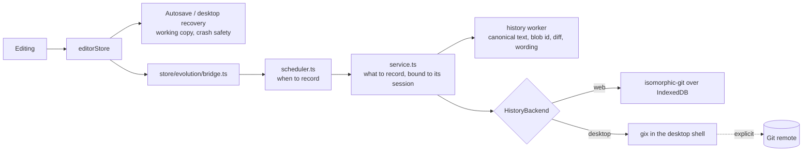

# Canvas Evolution: architecture and decisions

Canvas Evolution records each diagram's history as genuine Git, in the background, with no Git step
asked of the person. This page is the developer reference: how it is built, why, and the invariants
that hold it together. The person-facing guide is [Diagram history](../guides/history.md); the threat
model is [Canvas Evolution security](evolution-security.md).

## Three layers, kept apart

| Layer | Responsible for | Never |
| --- | --- | --- |
| Working copy (autosave, desktop recovery copies) | Durability of what is on screen, crash recovery | Waits on history |
| History (this feature) | Revisions, timeline, compare, alternatives, restore, merge | Changes the working copy except through an explicit, journaled operation |
| Remote (desktop, opt-in) | Fetch and publish | Runs without an explicit choice; force-pushes; touches local capture |

## Decisions

### ADR-1: reuse Git implementations, own only the semantics

- **Web:** [isomorphic-git](https://github.com/isomorphic-git/isomorphic-git) (MIT), in a dedicated
  module worker (`src/evolution/worker.ts`). It writes and reads loose and packed objects, indexes
  packs (deltas included), writes packs, finds merge bases and walks ancestry. It needs a global
  `Buffer`, so the worker installs [`buffer`](https://github.com/feross/buffer) (MIT) before
  isomorphic-git loads (`bufferGlobal.ts`); the editor's thread loads neither. Its HTTP client is never
  imported.
- **Desktop:** [gix](https://github.com/GitoxideLabs/gitoxide) in the shell (`src-tauri/src/history/`),
  network features off. It adds true compare-and-swap ref transactions and on-disk repositories that
  standard Git reads in place.
- **Owned, narrowly:**
  - Bundle header framing (`bundle.ts`): no library here writes or reads bundles.
  - The pack pre-scan (`packScan.ts`): neither library bounds how far one object may inflate.
  - The IndexedDB file system (`browser/kvfs.ts`): LightningFS flushes on a debounce, so a closed tab
    could lose a write it had reported done.
  - Compare-and-swap on top of isomorphic-git, done under a Web Lock.
  - A bounded history walk, so both backends list revisions in one order.
- **One contract, two backends:**
  - `VersionStore` and `HistoryBackend` (`contracts.ts`, `backend.ts`) are the only Git surface the
    editor sees.
  - `tests/fixtures/evolution/contract.json` holds canonical documents and the commit ids standard Git
    computes for them.
  - `tests/evolution/igit-store.test.ts` (web), the Rust tests in `src-tauri/src/history/` (desktop)
    and real `git` all reproduce those ids.
- **Interoperability:**
  - Bundles round-trip with standard Git both ways: `git clone` of ours, and import of Git's,
    deltas included.
  - Only SHA-1 histories are supported. SHA-256 and partial (filtered) bundles are refused by name.

### ADR-2: identity: history follows the working copy

| Concept | What it is |
| --- | --- |
| Document identity | `metadata.id`: a lineage hint that travels with the file, so two files may share it |
| History identity | `repoId`, minted when a history starts |
| Working copy | A library entry (`lib_<id>`), a Quick Draft (`draft_<recovery id>`) or a saved file (`file_<path>`) |
| Binding | `copyId → { repoId, altId, paused }`, kept beside the histories, never in the file |
| Alternative | A stable `altId`; its branch is `refs/heads/alt/<altId>`, and its name is display only |
| Editor session | One history session per open working copy (`service.ts`, a token every async step checks) |
| Generation | `editorStore.revision`, which grows with every edit and load |
| Ref generation | The commit id a branch holds, moved only by compare-and-swap |

Rules:

- **New copies.** A copy with no binding whose `metadata.id` matches an existing history is offered
  "Continue its history" or "Start new history". Capture waits for the answer. Histories are never
  joined or forked on the id alone (`identity.ts`).
- **One writer per copy.** One editor records a copy's history: a Web Lock per copy, held for the
  session (`bridge.ts`). Another tab with the same diagram shows history read-only. Where the browser
  has no Web Locks, history is off and the status says so.
- **Repository locks.** A repository's lock only serialises ref updates and changes to its
  `repo.json`, each read again under it (`changeMeta`). Two copies on different alternatives of one
  history may record at once; each moves only its own branch, by compare-and-swap.
- **Active alternative.** Which alternative a copy is on lives in its binding, not in the repository,
  so two sessions never fight over a global "current branch".
- **Per copy, not per history.** A pause lives in the binding too, so copies continuing one history
  pause separately (`repo.json`'s old `paused` is only read, and lifted on resume). Removing history
  from one of them deletes only its binding while another copy is bound to it; deleting the shared
  history is a separate choice the person makes. A library diagram deleted since keeps its binding,
  so a restored backup takes it back to its history, but it no longer counts as another copy.

### ADR-3: one recoverable operation protocol

- **Checkpoints need no journal.** Objects are content-addressed and immutable. One compare-and-swap
  makes them reachable, and a crash before it leaves unreachable objects that maintenance prunes after
  14 days.
- **Every other operation is journaled.** This covers switching alternatives, restoring, finishing a
  merge, a remote fast-forward and adopting an external change. Each records `prepared →
  pointer-moved → working-reconciled` in the repository's journal before each next step
  (`journal.ts`).
- **Restore and merge move history first.** The restoration or merge commit is written and the branch
  moved before the editor changes. A crash in between leaves the editor on the old content, which then
  reads as uncaptured work. Nothing is lost.

At each interruption boundary, recovery decides as follows:

| Interrupted after | Source of truth | Recovery |
| --- | --- | --- |
| `prepared`, pointer unmoved | Old ref and the autosaved working copy | Discard the entry |
| Pointer moved, working copy as it was | The new ref | Complete: load the target into the working copy |
| Pointer moved, working copy changed since | Both | Ask: Resume or Keep current. Both versions stay |
| Pointer moved elsewhere (another writer) | The other writer's ref | Discard as stale |
| `working-reconciled` | Everything is in place | Remove the entry |

A switch whose binding had already moved asks the same way. Until the person answers, nothing is
recorded on either alternative, and Keep current puts the binding back on the alternative it left.

Durability:

- **Desktop.** Write a temp file, fsync it, rename it, then fsync the directory on Unix. Atomic
  replace with write-through on Windows. gix writes ref lock files.
- **Web.** Each IndexedDB write is its own transaction with `durability: 'strict'`, resolved once
  committed. Web Locks are released by the browser when a tab dies.

### ADR-4: automatic history never writes to an external repository

- **Histories live in the app's own storage.** Web: IndexedDB `draft-canvas-history`. Desktop:
  `<app data>/history/<repoId>.git`. Never beside the diagram, never in the folder it was opened from.
- **A project folder that is a Git repository gets nothing from recording.** No objects, refs, hooks,
  index or working-tree changes, whatever the folder holds (`desktop/history.ts`).
- **Publishing is a separate, explicit action.** Copying revisions to a remote, or into a project's
  own repository, happens only when the person asks, never as a side effect of capture, and never
  holds up capture or the working copy. On the desktop it runs the person's own `git`, hardened as
  [Running Git](evolution-security.md#running-git-for-remotes-and-project-repositories-desktop)
  describes. Remote revisions come in through the same merge as alternatives (`startMerge` with
  `remote`). Committing into a project goes to the diagram's own branch by default
  (`src-tauri/src/history/project.rs`), and the page drives both through `desktop/remoteHistory.ts`.
  A file changed on disk and reloaded is recorded as a revision with `initiator: external`.

### ADR-6: one content model

- **What a revision stores.** `diagram.draftcanvas`: the canonical serialization of
  `historyContent(file)` (`document/content.ts`). Only `metadata.updatedAt` and each room's camera are
  pinned; every other durable field is kept exactly.
- **What counts as "nothing changed".** Byte equality of that text, which is blob-id equality.
  `tests/evolution/content-diff.test.ts` holds this to the semantic diff over seeded random edits: the
  diff lists a change exactly when the bytes differ.
- **Old revisions are never rewritten.** They are migrated in memory when read (`snapshot.ts`), as an
  old file is.

### ADR-7: a semantic three-way merge, decided by the person

The engine is `evolution/merge.ts`, run in the history worker; the protocol around it is
`store/evolution/merging.ts`. It merges documents, never text. Changes are matched by id
(`collab/diff.ts`) and merged in units that mean something together:

| Unit | Fields merged as one |
| --- | --- |
| Connector ends | `source`, `target`, both anchors, `portal` |
| Connector path | `routing`, `routeMode`, `waypoints` |
| Geometry | `x`, `y`, `width`, `height` |
| Containment | `parentId`, and which room the element is in |
| Junction link | `link`, and the label a linked Junction shares with its group |
| Sequence | The whole payload |
| Style | The diagram's whole style, drawings included |

Everything else merges field by field.

- **Conflicts are never last-writer-wins.** The same change on both sides is not a conflict. Anything
  else both sides touched is listed with all three versions until the person chooses a side:
  `both-changed`, `removed-and-changed`, `same-id`, `moved-apart`, and `file` (title, settings,
  style, level or order). The candidate shown while deciding resolves open conflicts toward `ours`;
  finishing requires a choice for every one (`mergeReady`).
- **Validation conflicts.** The combination is applied to the ancestor and checked whole.
  Whatever `repairReferences` would drop (a connector to a shape the other side removed), a boundary
  the two sides together put inside itself, and any repair `normalizeDocument` would make become
  `combination` conflicts, never silent repairs.
- **Already included or simply ahead.** No merge commit. A fast-forward moves the branch to the other
  tip through the journaled protocol (ADR-3) and applies it as one undo step.
- **Several merge bases.** `virtualBase` folds them pairwise when each pair has one common ancestor
  and merges cleanly; otherwise the merge stops and asks the person to merge step by step. Two
  histories with no common ancestor are refused.
- **A durable session.** The choices are kept in the journal (`kind: 'merge-session'`, rewritten on
  every choice), and `refs/draft-canvas/merge/<id>/theirs` keeps the other side's objects reachable
  so maintenance never prunes them. On attach, a session whose `ours` is still the tip is offered back
  with its choices; otherwise it is dropped. Cancel removes both.
- **Finishing re-checks everything it read.** Both branch tips and the blob id of the live content
  must still match the session's start, so a collaborator's newer edit is never overwritten because
  the branches happened not to move. Then a two-parent commit, a journaled compare-and-swap, and
  `applyToFile` at the generation the session began at. If the editor moved meanwhile, the merge is
  in history, nothing on the canvas is replaced and the person is asked.

### ADR-8: checkpoint semantics

- **Edits.** A `revision` bump only marks the copy dirty.
- **When a revision is recorded.** At a boundary (no gesture held), after 30 s of quiet or 120 s of
  steady editing. Both intervals are set in Settings → History.
- **Agent edits.** Agent commits (`host/agentBridge.ts`) are coalesced and recorded once the agent has
  been quiet for 3 s.
- **One capture at a time.** Edits made meanwhile stay pending.
- **Failures.** A failure retries with backoff and shows in the status. Drawing and autosave never
  wait.
- **No empty commits.** An undo back to the recorded content records nothing.
- **Messages.** Deterministic and factual (`summary.ts`), with trailers (`trailers.ts`) that are
  sanitised both ways.

### ADR-9 and ADR-11: the timeline and the history lens

- **Live is an endpoint, not a revision.** The timeline always ends in Live, the diagram as it is
  now (`historyView.ts`'s `showLive`). Stepping past the newest revision returns to it; the lens
  eases to the live content, then closes.
- **Sessions are presentation only.** Revisions more than 20 minutes apart start a new session
  (`timeline.ts`). A session's label is its net change, start to end, worked out once in the worker
  and cached. Git's history underneath is never collapsed.
- **One renderer.** The lens (`canvas/HistoryLens.tsx`) draws a revision with the shared scene
  renderer, `renderDocumentSvg`: the same display lists as the canvas and every export
  (`nodes/describe.ts`, `edges/describe.ts`), in the revision's own style and routing. There is no
  history-only drawing to drift. The live layers are hidden under it
  (`.react-flow:has(.dc-history-lens)`) and keep receiving changes; `uiStore.historyLens` makes the
  editor read-only while it is up.
- **Transitions keyed by id.** Shapes in both revisions glide from where they were, new ones fade and
  scale in, removed ones fade out from the outgoing picture, and connectors redraw once their shapes
  settle. The animation uses the individual `translate` and `scale` properties because a shape's
  group is placed by its own `transform` attribute, which `transform` would replace. A newer step
  cancels the one in flight, reduced motion shows each revision at once, and a timer finishes every
  animation so a throttled background tab still ends on the right picture.
- **Camera.** `presentation/revisionFraming.ts` is pure, like `framing.ts`, and reuses `frameStep`:
  a change already in view keeps the camera still, one partly off screen is nudged, and only a change
  elsewhere is flown to. It moves only when **Follow changes with the camera** is on.
- **Compare draws over the lens** (`canvas/CompareLayers.tsx`). Every change has a mark and a glyph,
  never colour alone. Side by side follows one camera.

### ADR-12: history in live collaboration

- **Owner-only capture.** Only the owner's editor records, from the owner's canvas. A guest's copy is
  opened read-only for history: capture is off and the timeline is unavailable.
- **Attribution by changed keys.** At capture, `collabBridge.ts`'s `historyAttribution` intersects the
  keys the revision changed with the session's authorship touches. A person is credited only when
  the revision contains their change; being connected, or making changes that were all undone, is
  not enough. Names are written as `Draft-Canvas-Contributor: <name> (unverified)`.
- **`Draft-Canvas-Collab-Seq`.** The owner's collaboration commit number at capture, tying a revision
  to a point in the session.
- **Session end is a capture boundary.** `stopHosting` freezes the authorship touches and sequence
  number, then requests a capture, so what the session changed is recorded with its contributors
  before the authorship record is discarded.
- **Switching, exploring and merging alternatives are refused during a session.** Each would replace
  everyone's diagram at once. Restore and Bring back are ordinary edits through `applyToFile`, with
  the generation check, so a newer collaborator edit is never overwritten.
- **No guest access to history.** History holds what a diagram used to contain, including content the
  owner removed, so sending it would reveal more than the canvas on screen. The owner's file is the
  single authority, and a guest's copy is never saved, so there is nothing of the guest's to record.
  `src/collab/` does not import history, and no collaboration message carries it.

### ADR-13: `diagram_history`, a reviewed view for agents

Served by the page that has the diagram open (`store/evolution/agentTool.ts`, reached through the
desktop broker like `read_selection`). Another diagram answers `NOT_ACTIVE`. The tool is annotated
`readOnlyHint: true`.

| Action | Class | Returns |
| --- | --- | --- |
| `summary` | Read: summaries | Current revision id, alternative, alternatives, milestones, whether a capture is pending |
| `list` | Read: summaries | Up to 100 revisions, newest first: id, time, summary, categories, initiator, milestones; `query` filters |
| `compare` | Read: summaries | The semantic diff (up to 200 elements) and its wording, between two revisions or a revision and `live` |
| `preview_restore` | Preview | What restoring a revision would change. Never applied |
| `preview_merge` | Preview | How much combines and which conflicts need a decision. Never applied; several bases return a note |
| `suggest_milestone` | Request | A suggestion in the history details; nothing is named until the person accepts |
| `read` | Full content | A whole past revision, only when **Let agents read past revisions in full** is on (`history-agents-read`, off by default); otherwise `READ_ONLY` |

- Revisions are addressed only by the 40-hex ids `list` returns. No raw Git, ref names, Git
  commands or other diagrams' histories.
- Restoring, merging, switching and naming stay the person's actions in the timeline.
- `HistoryToolError` codes map to the broker's: `NOT_ACTIVE`, `NOT_FOUND` (no history, unknown
  alternative), `READ_ONLY` (full reads not allowed) and `INVALID_INPUT`.

### ADR-15: storage policy

- **Web.** Revisions are written as loose objects. Maintenance packs the reachable loose objects into
  one pack, without deltas (isomorphic-git writes none), and removes unreachable loose objects older
  than 14 days. It skips a repository with an open journal entry.
- **When.** The history service runs maintenance in the background after every 40 revisions it
  records, on either backend.
- **Desktop.** Maintenance removes unreachable loose objects older than 14 days and nothing else:
  there is no repack. A `git gc` run by hand on the repository works.
- **Growth.** Measured on the web backend at about 1.1 MB per 100 revisions of a 160 KB diagram,
  the same packed or loose, since packs here carry no deltas (`benchmark/history.ts`).
- **Never to make room.** History never deletes reachable revisions to free space; a quota failure
  pauses history (see [security](evolution-security.md#threats-and-mitigations)).

## Invariants

- `src/evolution/` is React-free, store-free and DOM-free. It may import `document/`, `depth/`, the
  canonical serializer and the listed pure `collab/` helpers only (`tests/layering.test.ts`).
- History state in the editor (`store/evolution/evolutionStore.ts`) is never saved, undone, shared or
  exported.
- Nothing in history changes the working copy except a journaled operation, and those go through
  `editorStore.applyToFile` as one undo step.
- An operation that replaces what is on screen with a recorded revision (switching, exploring,
  bringing an alternative in) starts only from the branch's tip. While recording is paused or off,
  `flush` records nothing, so unrecorded content refuses the operation; it is never recorded anyway.
- Every ref name is built from ids (`refs.ts`), and every ref read from outside passes
  `isSafeRefName`.
- Every revision read back passes `parseDocument`. A tree that is not exactly `{ diagram.draftcanvas }`
  is refused.

## Performance

Medians from `npx tsx benchmark/history.ts` on Windows with Node 22. All of this runs off the drawing
thread, in the history worker or the desktop shell; the drawing thread only hands over an immutable
snapshot. The benchmark checks the medium workload against budgets in its header.

- **Medium workload** (200 shapes, 300 connectors, a 160 KB file): canonical text and blob id
  1.8 ms; semantic diff and wording 0.2 ms; three-way merge 2.6 ms; recording a revision on the web
  backend 4.6 ms; listing 100 revisions 11 ms.
- **Large workload** (500 shapes, 800 connectors, a 404 KB file): canonical text and blob id 4.3 ms;
  semantic diff and wording 0.1 ms; three-way merge 6.2 ms; recording a revision on the web backend
  8.2 ms; listing 100 revisions 10 ms.

## Known limitations

- **No editing of a merge candidate on the canvas.** Conflicts are resolved by choosing a side per
  unit. Further changes are made after the merge, as ordinary edits.
- **No guest history browsing** in live sessions (ADR-12).
- **No remotes in the web app.** The web exports and imports bundles only.
- **Web packs have no deltas.** isomorphic-git writes none, so a packed history is larger than Git's
  own `gc` would make it.
- **Desktop maintenance does not repack.** It only prunes unreachable loose objects.
- **The lens draws with the export renderer.** Canvas-only chrome is not shown in a past revision:
  selection, handles, and the ring around linked Junctions.
- **`diagram_history` serves only the open diagram.** Another diagram's history answers `NOT_ACTIVE`.

## Testing

| Suite | Covers |
| --- | --- |
| `tests/evolution/igit-store.test.ts` | Contract ids, compare-and-swap races, walk order, maintenance, real-Git interop (`fsck`, `log`, `show`, `clone`, delta bundles) |
| `tests/evolution/pack-scan.test.ts` | Decompression bombs, oversize objects, malformed packs, real Git packs |
| `tests/evolution/content-diff.test.ts` | Content model, byte/diff agreement (seeded), wording |
| `tests/evolution/protocol.test.ts` | Journal recovery decisions, identity decisions, trailer forging, ref and bundle validation |
| `tests/evolution/scheduler.test.ts` | Idle and maximum intervals, gesture boundaries, agent coalescing, backoff |
| `tests/evolution/service.test.ts` | End-to-end capture on a real backend, no-op after undo, a switch mid-capture, identity questions |
| `tests/evolution/timeline.test.ts` | Session grouping, search, milestone parsing, revision framing |
| `tests/evolution/operations.test.ts` | Restore and Bring back as one undo step, alternatives, interrupted-operation recovery, merging and fast-forward, the agent history tool |
| `tests/desktop/remote-history.test.ts` | Remote settings kept in the history, nothing sent on connect, the first publish confirmed, milestones-only publishing, offline state |
| `src-tauri/src/history/git_tests.rs` | The hardened Git runner against real Git: refused repository settings, hooks never run, holding-area fetch, isolated and guarded project commits, push previews |
| `tests/evolution/merge.test.ts` | Merge units, conflict kinds, validation conflicts, one-sided changes kept (seeded) |
| `tests/evolution/faults.test.ts` | Full storage, a ref move that failed after objects were written, racing writers, damaged revisions |
| `e2e/history.spec.ts` | Background recording across a reload, the lens leaving the live diagram alone, compare and restore in the browser |
| `benchmark/history.ts` | The [performance](#performance) medians and their budgets |

The real-Git tests are mandatory under `CI`. Regenerate fixtures only for a deliberate format change:
`npx tsx tests/fixtures/evolution/generate.ts`.
