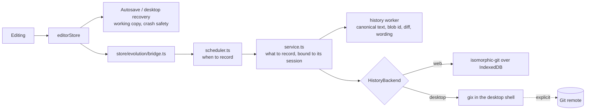

# Canvas Evolution: architecture and decisions

Canvas Evolution records each diagram's history as genuine Git, in the background, with no Git step
asked of the person. This page is the developer reference: how it is built, why, and the invariants
that hold it together. The person-facing guide is [Diagram history](../guides/history.md); the threat
model is [Canvas Evolution security](evolution-security.md).

## Three layers, kept apart

| Layer | Responsible for | Never |
| --- | --- | --- |
| Working copy (autosave, desktop recovery copies) | Durability of what is on screen, crash recovery | Waits on history |
| History (this feature) | Revisions, timeline, compare, alternatives, restore, merge | Changes the working copy except through an explicit, journaled operation |
| Remote (desktop, opt-in) | Fetch and publish | Runs without an explicit choice; force-pushes; touches local capture |

## Decisions

### ADR-1: reuse Git implementations, own only the semantics

- **Web:** [isomorphic-git](https://github.com/isomorphic-git/isomorphic-git) (MIT), in a dedicated
  module worker (`src/evolution/worker.ts`). It writes and reads loose and packed objects, indexes
  packs (deltas included), writes packs, finds merge bases and walks ancestry. It needs a global
  `Buffer`, so the worker installs [`buffer`](https://github.com/feross/buffer) (MIT) before
  isomorphic-git loads (`bufferGlobal.ts`); the editor's thread loads neither. Its HTTP client is never
  imported.
- **Desktop:** [gix](https://github.com/GitoxideLabs/gitoxide) in the shell (`src-tauri/src/history/`),
  network features off. It adds true compare-and-swap ref transactions and on-disk repositories that
  standard Git reads in place.
- **Owned, narrowly:**
  - Bundle header framing (`bundle.ts`): no library here writes or reads bundles.
  - The pack pre-scan (`packScan.ts`): neither library bounds how far one object may inflate.
  - The IndexedDB file system (`browser/kvfs.ts`): LightningFS flushes on a debounce, so a closed tab
    could lose a write it had reported done.
  - Compare-and-swap on top of isomorphic-git, done under a Web Lock.
  - A bounded history walk, so both backends list revisions in one order.
- **One contract, two backends:**
  - `VersionStore` and `HistoryBackend` (`contracts.ts`, `backend.ts`) are the only Git surface the
    editor sees.
  - `tests/fixtures/evolution/contract.json` holds canonical documents and the commit ids standard Git
    computes for them.
  - `tests/evolution/igit-store.test.ts` (web), the Rust tests in `src-tauri/src/history/` (desktop)
    and real `git` all reproduce those ids.
- **Interoperability:**
  - Bundles round-trip with standard Git both ways: `git clone` of ours, and import of Git's,
    deltas included.
  - Only SHA-1 histories are supported. SHA-256 and partial (filtered) bundles are refused by name.

### ADR-2: identity: history follows the working copy

| Concept | What it is |
| --- | --- |
| Document identity | `metadata.id`: a lineage hint that travels with the file, so two files may share it |
| History identity | `repoId`, minted when a history starts |
| Working copy | A library entry (`lib_<id>`), a Quick Draft (`draft_<recovery id>`) or a saved file (`file_<path>`) |
| Binding | `copyId → { repoId, altId }`, kept beside the histories, never in the file |
| Alternative | A stable `altId`; its branch is `refs/heads/alt/<altId>`, and its name is display only |
| Editor session | One history session per open working copy (`service.ts`, a token every async step checks) |
| Generation | `editorStore.revision`, which grows with every edit and load |
| Ref generation | The commit id a branch holds, moved only by compare-and-swap |

Rules:

- **New copies.** A copy with no binding whose `metadata.id` matches an existing history is offered
  "Continue its history" or "Start new history". Capture waits for the answer. Histories are never
  joined or forked on the id alone (`identity.ts`).
- **One writer per copy.** One editor records a copy's history: a Web Lock per copy, held for the
  session (`bridge.ts`). Another tab with the same diagram shows history read-only. Where the browser
  has no Web Locks, history is off and the status says so.
- **Repository locks.** A repository's lock only serialises ref updates. Two copies on different
  alternatives of one history may record at once; each moves only its own branch, by
  compare-and-swap.
- **Active alternative.** Which alternative a copy is on lives in its binding, not in the repository,
  so two sessions never fight over a global "current branch".

### ADR-3: one recoverable operation protocol

- **Checkpoints need no journal.** Objects are content-addressed and immutable. One compare-and-swap
  makes them reachable, and a crash before it leaves unreachable objects that maintenance prunes after
  14 days.
- **Every other operation is journaled.** This covers switching alternatives, restoring, finishing a
  merge, a remote fast-forward and adopting an external change. Each records `prepared →
  pointer-moved → working-reconciled` in the repository's journal before each next step
  (`journal.ts`).
- **Restore and merge move history first.** The restoration or merge commit is written and the branch
  moved before the editor changes. A crash in between leaves the editor on the old content, which then
  reads as uncaptured work. Nothing is lost.

At each interruption boundary, recovery decides as follows:

| Interrupted after | Source of truth | Recovery |
| --- | --- | --- |
| `prepared`, pointer unmoved | Old ref and the autosaved working copy | Discard the entry |
| Pointer moved, working copy as it was | The new ref | Complete: load the target into the working copy |
| Pointer moved, working copy changed since | Both | Ask: Resume or Keep current. Both versions stay |
| Pointer moved elsewhere (another writer) | The other writer's ref | Discard as stale |
| `working-reconciled` | Everything is in place | Remove the entry |

Durability:

- **Desktop.** Write a temp file, fsync it, rename it, then fsync the directory on Unix. Atomic
  replace with write-through on Windows. gix writes ref lock files.
- **Web.** Each IndexedDB write is its own transaction with `durability: 'strict'`, resolved once
  committed. Web Locks are released by the browser when a tab dies.

### ADR-6: one content model

- **What a revision stores.** `diagram.draftcanvas`: the canonical serialization of
  `historyContent(file)` (`document/content.ts`). Only `metadata.updatedAt` and each room's camera are
  pinned; every other durable field is kept exactly.
- **What counts as "nothing changed".** Byte equality of that text, which is blob-id equality.
  `tests/evolution/content-diff.test.ts` holds this to the semantic diff over seeded random edits: the
  diff lists a change exactly when the bytes differ.
- **Old revisions are never rewritten.** They are migrated in memory when read (`snapshot.ts`), as an
  old file is.

### ADR-8: checkpoint semantics

- **Edits.** A `revision` bump only marks the copy dirty.
- **When a revision is recorded.** At a boundary (no gesture held), after 30 s of quiet or 120 s of
  steady editing. Both intervals are set in Settings → History.
- **Agent edits.** Agent commits (`host/agentBridge.ts`) are coalesced and recorded once the agent has
  been quiet for 3 s.
- **One capture at a time.** Edits made meanwhile stay pending.
- **Failures.** A failure retries with backoff and shows in the status. Drawing and autosave never
  wait.
- **No empty commits.** An undo back to the recorded content records nothing.
- **Messages.** Deterministic and factual (`summary.ts`), with trailers (`trailers.ts`) that are
  sanitised both ways.

## Invariants

- `src/evolution/` is React-free, store-free and DOM-free. It may import `document/`, `depth/`, the
  canonical serializer and the listed pure `collab/` helpers only (`tests/layering.test.ts`).
- History state in the editor (`store/evolution/evolutionStore.ts`) is never saved, undone, shared or
  exported.
- Nothing in history changes the working copy except a journaled operation, and those go through
  `editorStore.applyToFile` as one undo step.
- Every ref name is built from ids (`refs.ts`), and every ref read from outside passes
  `isSafeRefName`.
- Every revision read back passes `parseDocument`. A tree that is not exactly `{ diagram.draftcanvas }`
  is refused.

## Testing

| Suite | Covers |
| --- | --- |
| `tests/evolution/igit-store.test.ts` | Contract ids, compare-and-swap races, walk order, maintenance, real-Git interop (`fsck`, `log`, `show`, `clone`, delta bundles) |
| `tests/evolution/pack-scan.test.ts` | Decompression bombs, oversize objects, malformed packs, real Git packs |
| `tests/evolution/content-diff.test.ts` | Content model, byte/diff agreement (seeded), wording |
| `tests/evolution/protocol.test.ts` | Journal recovery decisions, identity decisions, trailer forging, ref and bundle validation |
| `tests/evolution/scheduler.test.ts` | Idle and maximum intervals, gesture boundaries, agent coalescing, backoff |
| `tests/evolution/service.test.ts` | End-to-end capture on a real backend, no-op after undo, a switch mid-capture, identity questions |

The real-Git tests are mandatory under `CI`. Regenerate fixtures only for a deliberate format change:
`npx tsx tests/fixtures/evolution/generate.ts`.
