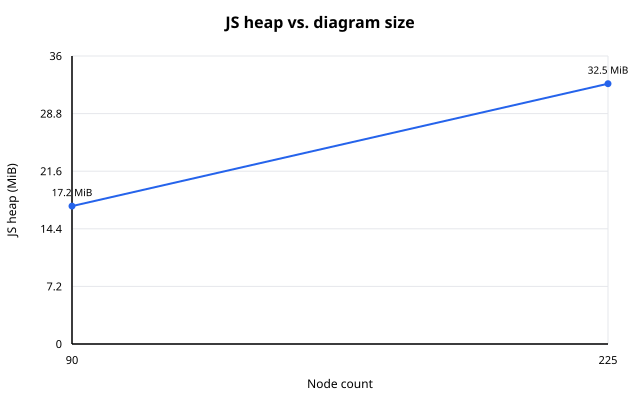

# Performance

How to measure Draft Canvas's speed and memory, and the budgets a release must meet. Every benchmark
runs in Chromium against the production build.

| Command | Measures |
| --- | --- |
| `npm run perf` / `perf:stress` | Load time, JS heap and a 40-step drag on real starter-based diagrams; `perf:stress` adds a larger workload |
| `npm run perf:interaction` | Frame times and input latency while panning, zooming, dragging and connecting |
| `npm run perf:lifecycle` | Opening, exporting, a 100-diagram Library, and memory over long sessions |
| `npm run perf:check` | The release gate; see [Performance acceptance](#performance-acceptance) |

## Latest results

Written by `npm run perf:publish` ([Publishing results](#publishing-results)). Edit only the prose
outside the markers.

<!-- performance-results:start -->
### At rest

On a typical architecture diagram (~90 nodes — services, databases, queues, boundaries), Draft Canvas loads in about 429 ms and settles at about 17 MiB of memory. A larger, more detailed diagram (~225 nodes) loads in about 502 ms and uses about 33 MiB.

| Diagram | Size | Load time | Memory (JS heap) | 40-step drag |
|---|---|---|---|---|
| Typical | 90 nodes / 73 connections | 429 ms | 17 MiB | 699 ms |
| Large | 225 nodes / 182 connections | 502 ms | 33 MiB | 689 ms |

Measured against the production build in Chromium, on real architecture diagrams (not synthetic shapes) built from Draft Canvas's own starter catalog. These are reference-machine numbers, not a guarantee for every device. The drag column is how long a scripted 40-step drag takes end to end — one step per frame at 60 Hz, so it is the length of the gesture rather than any lag in it; how each frame fares is in the next table.

Measured on: Apple M2 Pro, macOS 27.0.0, Chromium 153.0.8010.12, Draft Canvas 1.12.0.



### While you work

How long a frame takes while panning, zooming, selecting and dragging in a big diagram (95th percentile; 16.7 ms is one frame at 60 Hz), and the longest freeze after dropping a shape, drawing a connector or renaming one:

| Diagram | Pan | Zoom | Select a shape | Drag | Longest freeze after an edit |
|---|---|---|---|---|---|
| Medium — 200 shapes / 300 connectors | 16.8 ms | 16.7 ms | 33.4 ms | 16.7 ms | none over 50 ms |
| Large — 500 shapes / 800 connectors | 66.7 ms | 16.8 ms | 66.7 ms | 50.1 ms | 110 ms |
| Stress — 1,000 shapes / 1,500 connectors | 150.0 ms | 50.0 ms | 183.3 ms | 150.0 ms | 154 ms |

These diagrams are generated, deliberately dense ones: boundaries nested three deep, connectors that cross boundaries and each other, notes and code on shapes and connectors, and shapes with a room inside. Measured with real mouse input against the production build (new headless Chromium 153.0.8010.12, 1600×1000 @1x, 3 runs each).

### Opening one, and working for a long time

How long a diagram takes to appear after you choose it, the longest stretch the page cannot respond in that time, and what exporting it costs (SVG / PNG):

| Diagram | Opens in | Longest freeze while opening | Export |
|---|---|---|---|
| Small — 50 shapes / 75 connectors | 443 ms | 55 ms | – |
| Medium — 200 shapes / 300 connectors | 581 ms | 164 ms | 193 ms / 841 ms |
| Large — 500 shapes / 800 connectors | 845 ms | 356 ms | 102 ms / 1.8 s |
| Stress — 1,000 shapes / 1,500 connectors | 1.3 s | 715 ms | 161 ms / 2.1 s |

100 saved diagrams show up in the library in 89 ms. Switching between diagrams 25 times grew the JS heap by 0.9 MiB in total, and left no DOM nodes or listeners behind. Dragging a shape out and back 150 times on the large diagram — enough to fill the undo history — took the heap from 101 MiB to 103 MiB, where it stopped growing.

<!-- performance-results:end -->

## Performance acceptance

The supported workload is 200 shapes and 300 connectors, with nested boundaries, rooms, notes and
attachments. It is a regression target, not an import limit or a 60 Hz promise; larger diagrams work
but may lag.

`npm run perf:check` takes medians of three iterations after warmup. It fails on any limit in
[`benchmark/budgets.ts`](../../benchmark/budgets.ts), on an idle frame floor over 25 ms, and on any
missing, invalid or broken measurement. Tighten limits only from repeatable evidence.

The [Performance](../../.github/workflows/performance.yml) workflow runs the gate on tag pushes only,
on `ubuntu-24.04-arm` (the x64 pool varied between CPU generations), and keeps the interaction and
lifecycle reports for 14 days. Manual runs can add larger workloads and long sessions.

## Load and memory

```bash
npm run perf                 # Typical and Large, about 1–3 minutes
npm run perf:stress          # adds the Stress workload
npm run perf:save-baseline   # later runs print differences against benchmark/baseline.json
```

- Workloads (`benchmark/workloads/fixtures/`) are tiled from five starters in the frozen old catalog
  (`tests/fixtures/starters-v1/`). Regenerate them with `npm run perf:regen-fixtures` when those
  change.
- JS heap is `JSHeapUsedSize` after a forced GC: the JS heap only, not process memory.
- The drag's ~670 ms is the gesture's length at 60 Hz, not lag.
- `benchmark/baseline.json` and `benchmark/memory-chart.svg` (redrawn when a run measures two or more
  workloads) are committed on purpose. The baseline is informational: a laptop baseline does not
  compare with CI.

## Interaction

```bash
npm run perf:interaction                                          # all sizes and scenarios, ~30 min
npm run perf:interaction -- --sizes medium --scenarios drag-single,zoom-wheel
```

Fixtures come from a seeded generator (`benchmark/workloads/scale.ts`), so each size is identical
every run. The sizes are for investigation, not capacity claims. Scenarios are listed in
`benchmark/interaction/scenarios.ts`.

- 16.7 ms is the 60 Hz vsync floor, not headroom. Read it with the busy share.
- Compare runs of this harness only with each other. For a before/after comparison, use `--against`
  to measure both builds interleaved.
- Each result records the idle frame floor and flags anything over 20 ms. A laptop on low battery
  caps Chromium at 30 fps; use `--uncap-frames` when that cannot be avoided.
- `drag-commit` reports the worst frame and longest long task after the drop, when every connector is
  planned again; the drag's own percentiles never include it.
- For `depth-enter` and `depth-exit`, look at maximum frame time and key-to-next-frame latency as well
  as p95: a room swap can stall once before an otherwise smooth animation.

| Flag | Use |
| --- | --- |
| `--dist <dir>` | Measure a build made elsewhere |
| `--against <dist> --against-label <name>` | Measure another build interleaved, scenario by scenario |
| `--compare a.json b.json` | Print two saved results side by side |
| `--profile <dir>` | CPU-profile the first measured iteration; build with `vite build --minify false` for readable names |

## Lifecycle

```bash
npm run perf:lifecycle                                    # load, export, library, both soaks
npm run perf:lifecycle -- --only load,library --sizes medium
```

Memory is judged by slope, not a snapshot: after each soak cycle the harness forces GC, samples JS
heap, DOM nodes and listeners, and fits a line. A filled cache flattens; a leak keeps climbing. The
soaks exist to catch leaks such as memoized plans that keep scratch data through closures
([AGENTS.md](../../AGENTS.md), "Canvas and performance").

When waiting, use Playwright locators, not `page.waitForSelector`: its handle pins canvases and looks
like a DOM leak.

## Publishing results

Run `npm run perf`, plus `perf:interaction` and `perf:lifecycle` for their sections, then
`npm run perf:publish`. It rewrites only the region between the `performance-results` markers and
fails if they are missing.
