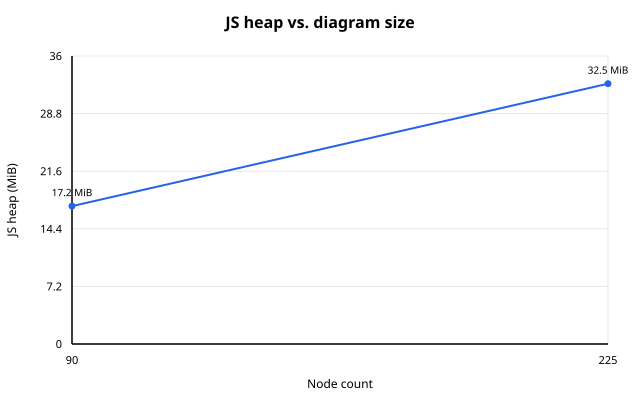

# Performance

Reproducible Chromium benchmarks against the production build.

| Command | Measures |
| --- | --- |
| `npm run perf` | Load time, JS heap and a 40-step drag on real starter-based diagrams |
| `npm run perf:interaction` | Frame times and input latency while panning, zooming, dragging and connecting |
| `npm run perf:lifecycle` | Opening, exporting, a 100-diagram Library, and memory over long sessions |
| `npm run perf:check` | The release gate; see [Performance acceptance](reliability.md#performance-acceptance) |

## Latest results

Written by `npm run perf:publish` ([Publishing results](#publishing-results)). Edit only the prose
outside the markers.

<!-- performance-results:start -->
### At rest

On a typical architecture diagram (~90 nodes — services, databases, queues, boundaries), Draft Canvas loads in about 429 ms and settles at about 17 MiB of memory. A larger, more detailed diagram (~225 nodes) loads in about 502 ms and uses about 33 MiB.

| Diagram | Size | Load time | Memory (JS heap) | 40-step drag |
|---|---|---|---|---|
| Typical | 90 nodes / 73 connections | 429 ms | 17 MiB | 699 ms |
| Large | 225 nodes / 182 connections | 502 ms | 33 MiB | 689 ms |

Measured against the production build in Chromium, on real architecture diagrams (not synthetic shapes) built from Draft Canvas's own starter catalog. These are reference-machine numbers, not a guarantee for every device. The drag column is how long a scripted 40-step drag takes end to end — one step per frame at 60 Hz, so it is the length of the gesture rather than any lag in it; how each frame fares is in the next table.

Measured on: Apple M2 Pro, macOS 27.0.0, Chromium 153.0.8010.12, Draft Canvas 1.12.0.



### While you work

How long a frame takes while panning, zooming, selecting and dragging in a big diagram (95th percentile; 16.7 ms is one frame at 60 Hz), and the longest freeze after dropping a shape, drawing a connector or renaming one:

| Diagram | Pan | Zoom | Select a shape | Drag | Longest freeze after an edit |
|---|---|---|---|---|---|
| Medium — 200 shapes / 300 connectors | 16.8 ms | 16.7 ms | 33.4 ms | 16.7 ms | none over 50 ms |
| Large — 500 shapes / 800 connectors | 66.7 ms | 16.8 ms | 66.7 ms | 50.1 ms | 110 ms |
| Stress — 1,000 shapes / 1,500 connectors | 150.0 ms | 50.0 ms | 183.3 ms | 150.0 ms | 154 ms |

These diagrams are generated, deliberately dense ones: boundaries nested three deep, connectors that cross boundaries and each other, notes and code on shapes and connectors, and shapes with a room inside. Measured with real mouse input against the production build (new headless Chromium 153.0.8010.12, 1600×1000 @1x, 3 runs each).

### Opening one, and working for a long time

How long a diagram takes to appear after you choose it, the longest stretch the page cannot respond in that time, and what exporting it costs (SVG / PNG):

| Diagram | Opens in | Longest freeze while opening | Export |
|---|---|---|---|
| Small — 50 shapes / 75 connectors | 443 ms | 55 ms | – |
| Medium — 200 shapes / 300 connectors | 581 ms | 164 ms | 193 ms / 841 ms |
| Large — 500 shapes / 800 connectors | 845 ms | 356 ms | 102 ms / 1.8 s |
| Stress — 1,000 shapes / 1,500 connectors | 1.3 s | 715 ms | 161 ms / 2.1 s |

100 saved diagrams show up in the library in 89 ms. Switching between diagrams 25 times grew the JS heap by 0.9 MiB in total, and left no DOM nodes or listeners behind. Dragging a shape out and back 150 times on the large diagram — enough to fill the undo history — took the heap from 101 MiB to 103 MiB, where it stopped growing.

<!-- performance-results:end -->
Regenerates the full results on this page, between `<!-- performance-results:start -->` and
`<!-- performance-results:end -->`, from `benchmark/results/latest.json`. Run `npm run perf` first.

## Load and memory

```bash
npm run perf          # Typical and Large, about 1–3 minutes
npm run perf:stress   # adds the Stress workload
```

Both build, serve and measure in headless Chromium, print a summary, and overwrite
`benchmark/results/latest.json`. With two or more workloads they also write
`benchmark/memory-chart.svg`.

Workloads are tiled from five real starters (microservices, event-driven, CQRS, hexagonal, saga) in
`benchmark/workloads/fixtures/`. Regenerate them with `npm run perf:regen-fixtures` when starters
change.

| Workload | Nodes / edges |
| --- | --- |
| Typical | 90 / 73 |
| Large | 225 / 182 |
| Stress (`perf:stress` only) | 500 / 398 |

- **Load:** import to render, until the node count matches and two idle frames pass.
- **JS heap:** `JSHeapUsedSize` after a forced GC. JS heap only, not process memory.
- **Drag:** one 40-step drag of the first node, one step per frame, undone after each run. About
  670 ms is the gesture's length at 60 Hz, not lag.
- Each value is the median of 3 runs after 1 warmup. The JSON also keeps `minMs` and `maxMs`.

### Baseline

```bash
npm run perf:save-baseline
```

Saves `benchmark/baseline.json` (committed deliberately). Later `perf` and `perf:stress` runs print
percentage differences against it. Informational only; a laptop baseline does not compare with CI.

## Interaction

```bash
npm run perf:interaction                                          # all sizes and scenarios, ~30 min
npm run perf:interaction -- --sizes medium --scenarios drag-single,zoom-wheel
```

Drives the production build with real mouse and keyboard input, one pointer event per frame.
Fixtures come from a seeded generator in `benchmark/workloads/scale.ts`, so each size is identical
every run. They include boundaries three deep, crossing connectors, notes and code, and rooms.

| Size | Shapes / connectors | Rooms |
| --- | --- | --- |
| Small | 50 / 75 | 1 |
| Medium | 200 / 300 | 3 |
| Large | 500 / 800 | 6 |
| Stress | 1,000 / 1,500 | 10 |

These are investigation sizes, not capacity claims.

Scenarios (`benchmark/interaction/scenarios.ts`): `pan-drag`, `pan-wheel`, `zoom-wheel`,
`drag-single`, `drag-multi`, `drag-boundary`, `drag-note`, `connect`, `hover-sweep`,
`select-clicks`, `type-label`, `panels`, `depth-enter`, `depth-exit`. Each has an unmeasured prepare,
a measured run, and a tail that captures debounced work such as autosave.

Reported (`benchmark/interaction/stats.ts`): frame-time p50/p95/p99/max, share of frames over 20 ms
and 33 ms, frames over 50 ms, input latency, long tasks and Long Animation Frames, main-thread busy
share, script/layout/style time, and page errors.

### Looking inside and back out

```bash
npm run perf:interaction -- --sizes small,medium,large --scenarios depth-enter,depth-exit
```

The depth scenarios use `benchmark/workloads/depth.ts`: a parent and an inside room with the same
shape and connector counts as the selected size, including boundaries, labels and attachments.
They exercise both the outgoing room's snapshot and the arriving room's mount. Each direction is
measured separately, from the real keyboard shortcut through removal of the transition, followed
by a one-second tail for debounced saves. Selection, the reverse move and its saves are unmeasured.
The JSON records this fixture under `<size>-depth` alongside the ordinary interaction fixture.

Use `--against /path/to/baseline/dist --against-label before` to compare builds in one run. Inspect
maximum frame time and key-to-next-frame latency as well as p95: a room swap can stall once before
an otherwise smooth animation. The recorder keeps the last idle frame so that initial stall is
included, and observes keydown as well as pointer and wheel input. Results from older harnesses
that discarded the initial frame or omitted keydown latency are not directly comparable.

Each iteration's `notes` also separates startup (`depthStartupMs`, shortcut to the first observed
running animation frame) from running-motion frame p95/max. `depthFirstTimelineMs` records how far
the animation had already advanced at that first frame; a large value reveals a skipped beginning.
Startup remains included in the overall frame and long-task measurements.

Room flights use decoded, camera-sized bitmaps from the shared SVG renderer. The editable room
stays measured at its landing camera underneath: scaling inline SVG text can otherwise trigger
font layout throughout the zoom even on a compositor layer. Bitmaps are capped at four million
pixels; at most two prepared cameras are cached, cleared when the file changes or editor closes.
Carried pictures are bounded and cleared on completion or interruption. Large rooms still pay
their initial mount and picture-preparation cost; use the startup metric to track that separately
from running motion. The normal warmup measures revisits; use `--warmup 0` to include a cold first
visit. `depthPictureCached` in each iteration's notes identifies arrival-image reuse.

Reading results:

- 16.7 ms is the 60 Hz vsync floor, not headroom. Read it with the busy share.
- Compare runs of this harness only with each other.
- Each result records the idle frame floor and flags anything over 20 ms. A laptop on low battery
  caps Chromium at 30 fps; use `--uncap-frames` when that cannot be avoided.

| Flag | Use |
| --- | --- |
| `--dist <dir>` | Measure a build made elsewhere |
| `--against <dist> --against-label <name>` | Measure another build interleaved, scenario by scenario. Use this for any before/after comparison |
| `--compare a.json b.json` | Print two saved results side by side |
| `--profile <dir>` | CPU-profile the first measured iteration. Build with `vite build --minify false` for readable names |
| `--iterations`, `--warmup`, `--out`, `--skip-build`, `--headed` | Run control |

## Lifecycle

```bash
npm run perf:lifecycle                                    # load, export, library, both soaks
npm run perf:lifecycle -- --only load,library --sizes medium
```

`benchmark/lifecycle-cli.ts` measures:

- Cold **load** of each size, with its longest task.
- **SVG and PNG export** through the real dialog.
- The **Library with 100 diagrams**: time until every row and fingerprint shows.
- Two **soaks**: open, edit and switch diagrams 25 times; drag a shape out and back 150 times, which
  fills undo history and then trims it.

Memory is judged by slope, not a snapshot. After each cycle the soak forces GC and samples JS heap,
DOM nodes and listeners, then fits a line. A filled cache flattens; a leak keeps climbing.

Lessons the soaks taught:

- Memoized plans must not keep planner scratch alive through closures (AGENTS.md "Canvas and
  performance"). A draft crossing planner grew a Large heap to 316 MiB this way.
- Wait with a Playwright locator, not `page.waitForSelector`: its handle pinned every canvas and
  looked like a DOM leak.

## Publishing results

```bash
npm run perf:publish
```

Run `npm run perf` first. `benchmark/publish-results.ts` rewrites only the region between
`<!-- performance-results:start -->` and `<!-- performance-results:end -->`, from
`benchmark/results/latest.json`. It adds "While you work" when `benchmark/results/interaction.json`
exists and "Opening one, and working for a long time" when `benchmark/results/lifecycle.json`
exists. It fails if the markers are missing.

## CI

The [Performance](../../.github/workflows/performance.yml) workflow runs the `perf:check` steps on
tag pushes and keeps the interaction and lifecycle reports for 14 days. Pull requests and `main`
pushes skip it. Manual runs can add larger workloads and long sessions. See
[Performance acceptance](reliability.md#performance-acceptance).
