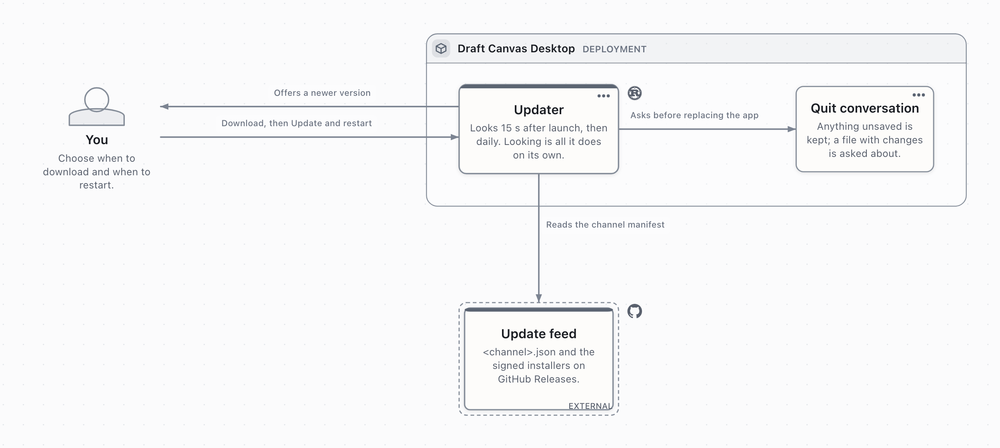

# Releases

How maintainers release Draft Canvas: the changelog, tags and gates, desktop updates and signing,
Homebrew, dependency triage, and withdrawing a bad release.

## Release notes

Write user-facing changes only in `CHANGELOG.md`. Release notes, desktop update notes and What's New
are generated from it (`scripts/changelog.mjs`).

- Group changes under `### Shared`, `### Desktop` or `### Web`, then
  [Keep a Changelog](https://keepachangelog.com/en/1.1.0/) categories at `####`: Added, Changed,
  Deprecated, Removed, Fixed, Security. Omit empty headings.
- An optional paragraph under the version heading becomes the What's New summary.
- Highlight a bullet with a bold title and `<!-- highlight -->`.
- Minor and major releases get a launch-style page; a patch opts in with `<!-- launch -->` on its own
  line in a platform section.
- A launch page can include screenshots listed in `docs/media/releases/vX.Y.Z/screenshots.json`: an
  array of `{ "file": "nodi.png", "alt": "What it shows", "platform": "desktop" }`, where platform is
  `shared`, `desktop` or `web` and `file` is a lowercase kebab-case PNG in the same directory. The
  generator validates the images. Without a manifest there is no gallery.

```markdown
### Shared

#### Changed

- **Clearer connectors** — captions stay visible while editing.
  <!-- highlight -->
```

## Release workflow

1. Rename `[Unreleased]` to `## [X.Y.Z] - YYYY-MM-DD` and add an empty `[Unreleased]` above it.
2. Set `package.json` and `package-lock.json` to `X.Y.Z`.
3. Update the compare links at the end of the changelog:

   ```markdown
   [X.Y.Z]: https://github.com/acltabontabon/draft-canvas/compare/vPREVIOUS...vX.Y.Z
   [Unreleased]: https://github.com/acltabontabon/draft-canvas/compare/vX.Y.Z...main
   ```

4. Preview the release notes and What's New:

   ```bash
   npm run release:notes -- vX.Y.Z
   npm run release:whats-new -- desktop    # or web
   ```

   Before the dated section exists, add `--draft`, or `--draft X.Y.Z` for What's New.

5. Commit, push, then push the `vX.Y.Z` tag.

The tag runs `release.yml`: full CI, a draft release, then the desktop release. After that succeeds,
the [website deploys](website.md#deploying) and, for stable tags, [Homebrew](#homebrew-releases)
updates.

## Versions and previews

- A release is tag `vX.Y.Z`, matching `package.json`; web and desktop share it.
- A desktop preview is tag `desktop-vX.Y.Z-alpha.N` or `-beta.N`. It runs `desktop-release.yml` on its
  own and creates a prerelease whose notes include Shared and Desktop changes. Its `X.Y.Z` may equal
  or lead `package.json`, never trail it.
- Every version, previews included, needs a dated `CHANGELOG.md` section.

## Release gates

- The desktop release publishes nothing and moves no update channel until the version and updater
  signatures check out, the arm64 macOS app starts, and the Windows app installs and starts. The
  Intel macOS package is cross-compiled and never started in CI.
- The headless CLI is built in the release's own `cli` job, with read access and no secrets, run
  once, and published as `Draft-Canvas_<version>_cli.mjs` beside the installers: it is in
  `SHA256SUMS.txt` and under the same build attestation. The architecture review action
  (`action.yml`) downloads that file and refuses it unless both check out.
- The web deploy publishes the artifact verified in the same run and checks its recorded commit.
- Performance budgets gate tag pushes only; see [Performance](performance.md#performance-acceptance).
- Keep release tags and publishing workflows limited to trusted maintainers.

## Desktop updates

What users see is in [Draft Canvas Desktop](../guides/desktop.md#updates).

<!-- Drawn in Draft Canvas: ../media/reference/desktop-updates.json, rendered by e2e/og-diagram.ts. -->


The app reads `github.com/acltabontabon/draft-canvas/releases/download/desktop-updates/<channel>.json`.
The installed version picks the channel, and nobody is downgraded:

| Installed | Reads | Is offered |
| --- | --- | --- |
| a prerelease (any `-suffix`) | `alpha.json` | the newest newer version, prerelease or release |
| a release | `stable.json` | newer releases only |

- The page has no updater permission; it calls the Rust `update_*` commands
  (`src-tauri/src/updater/`). Installing goes through the quit flow (`quit.rs`, `Purpose::Update`).
- A downloaded update lives in memory, so a restart re-downloads and re-verifies it.
- Keep the updater plugin's `zip` feature off (it pulls in vulnerable ZIP code), and `rustls-tls` and
  `system-proxy` on.

### Update channels

The release's `channels` job (`desktop-update-pointer.yml`) re-verifies the files from their public
addresses, then moves the rolling `desktop-updates` release forward: `stable.json` and `alpha.json`
for a release, `alpha.json` for a prerelease. Until it succeeds, nobody is offered the release. If it
fails, fix the cause and run **Actions → Desktop update channels** with the tag; there is no need to
rebuild.

### Signing

| Kind | Status | Secrets |
| --- | --- | --- |
| Update signing (Tauri minisign) | In use. The app refuses packages not signed by its built-in key for the announced version (`requireSignedVersion`). | `TAURI_SIGNING_PRIVATE_KEY`, `TAURI_SIGNING_PRIVATE_KEY_PASSWORD` |
| macOS code signing and notarization | Not configured; builds are ad-hoc signed | `APPLE_CERTIFICATE` (base64 `.p12`), `APPLE_CERTIFICATE_PASSWORD`, `APPLE_SIGNING_IDENTITY`, `APPLE_ID`, `APPLE_PASSWORD`, `APPLE_TEAM_ID` |
| Windows Authenticode | Not configured; installers are unsigned | `WINDOWS_CERTIFICATE` (base64 `.pfx`), `WINDOWS_CERTIFICATE_PASSWORD` |

- OS signing is optional: the `Prepare OS signing` step in `desktop-release.yml` uses its secrets
  when present, and nothing is skipped without them. Update signatures are always required.
- When OS signing is added, update the "not signed or notarized" text in `scripts/release-notes.mjs`.

### Update key setup

The public key is in `src-tauri/tauri.conf.json` (`plugins.updater.pubkey`). For a new key:

1. Run `npx tauri signer generate -w ~/.tauri/draft-canvas-updater.key` and choose a password.
2. Back up both the private key and its password offline. Installed copies accept only this key;
   losing it means everyone reinstalls by hand. Never commit it.
3. Put the `.pub` contents in `plugins.updater.pubkey`.
4. Add `TAURI_SIGNING_PRIVATE_KEY` (file contents) and `TAURI_SIGNING_PRIVATE_KEY_PASSWORD` as
   Actions secrets.

`node scripts/update-manifest.mjs check-config` reports readiness; releases fail without the secret
or a real key.

### Testing an update locally

1. Generate a throwaway key: `npx tauri signer generate --ci -p "" -w /tmp/dc-e2e.key`.
2. Write `e2e.conf.json` outside the repository: an old `"version"`, the throwaway pubkey,
   `endpoints: ["http://127.0.0.1:8787/{{channel}}.json"]`, `dangerousInsecureTransportProtocol: true`,
   `bundle.createUpdaterArtifacts: true`, and its own `identifier` and `productName`.
3. Build, copy the `.app` to a writable folder, then build again with a newer `"version"`:

   ```bash
   TAURI_SIGNING_PRIVATE_KEY=/tmp/dc-e2e.key TAURI_SIGNING_PRIVATE_KEY_PASSWORD= \
     npx tauri build --bundles app --config e2e.conf.json
   ```

4. Put the newer `.app.tar.gz` and `.sig` in a folder under their release names, such as
   `Draft-Canvas_<newer>_macOS_arm64.app.tar.gz`. The manifest needs a signature for every platform,
   so also copy the `.sig` as `Draft-Canvas_<newer>_macOS_x64.app.tar.gz.sig` and
   `Draft-Canvas_<newer>_Windows_x64.exe.sig`. Then serve a manifest, named `alpha.json` instead if
   the older build is a prerelease:

   ```bash
   node scripts/update-manifest.mjs build <newer> <folder> --base-url http://127.0.0.1:8787 > <folder>/stable.json
   python3 -m http.server 8787 --bind 127.0.0.1 --directory <folder>
   ```

5. Open the older copy. After about 15 seconds, choose **Download**, then **Update and restart**.

## Homebrew releases

After a stable desktop release (never a prerelease), `release.yml` runs `homebrew.yml`. It checks both
DMGs against `SHA256SUMS.txt`, updates only `Casks/draft-canvas.rb` in
[the tap](https://github.com/acltabontabon/homebrew-tap), and refuses older versions. A failure does
not affect the release, the web deploy or the update channels.

To retry, or after a manual desktop rebuild, run **Actions → Homebrew** with the stable tag. Fix
failures first; never bypass checksums.

### Credentials

1. Create an Ed25519 deploy key for Draft Canvas.
2. Add the public key to `acltabontabon/homebrew-tap` with write access.
3. Save the private key as the `HOMEBREW_TAP_DEPLOY_KEY` Actions secret in this repository.

`GITHUB_TOKEN` cannot push to the tap; missing credentials fail the workflow.

## Dependency triage

- `npm run audit:npm` scans both lockfiles and blocks unaccepted high and critical advisories.
- `npm run audit:rust` blocks vulnerabilities, unsoundness and yanked crates.
- Network errors and malformed reports fail. The scan also runs weekly.

Update compatible dependencies first. If no fix exists, add an entry to
[advisory-exceptions.json](../../.github/advisory-exceptions.json) with ecosystem, id, package,
reason, tracking reference and expiry. Expired or incomplete entries fail.

The current exception, RUSTSEC-2024-0429 (glib, reached only through Tauri's Linux GTK stack), records
its reasoning and way out in that file. It must be resolved before a Linux desktop build ships. Renew
it a month at a time, after checking `cargo update --dry-run` and `cargo tree -i glib` for each
target.

## Withdrawal and recovery procedure

1. Stop promoting the bad release. Never delete users' files or clear browser storage.
2. Desktop: run **Actions → Desktop update channels** with the last good tag and `force` on. This
   stops new offers but does not downgrade installed copies, so also ship a fix.
3. Homebrew: submit a reviewed tap correction. The automatic workflow refuses downgrades, and a tap
   rollback does not downgrade installed copies.
4. Web: run **Actions → Deploy the web** from `main` with `release-tag` set to the last good tag.
   Then check asset loading, reopening documents and service-worker scope.
5. Before offering an older editor, test it on exported disposable documents. If it cannot read
   current files, ship a forward fix instead. Never bypass validation or rewrite users' files.
6. Publish an incident note (affected versions, workarounds, recovery steps) and keep the bad release
   visible with a warning.
